# wordPass: the complete guide

**Bookworm × Minesweeper for the Nintendo DS.** You chain letter gems into words on a hex grid. Behind the board hides a
password, the *pass*. Hold a shoulder button to *peek*: peel away gems you can spare, read the numbers they leave behind,
and uncover the pass letter by letter. Spell weak words and the shelf catches fire.

This guide is the long form of the game. It is written to be read once from the top, and then used as a reference: every
number in it is checked against the game's source and data files by `tools/check_guide.py`, and every picture is taken from the
running game by `tools/emu/screens.py` (`make guide` redoes both). Where this guide and an older note disagree, the code is right
and this guide has been fixed.

## Contents

1. [Welcome and the five-minute quick start](#1-welcome-and-the-five-minute-quick-start)
2. [Screens and controls](#2-screens-and-controls)
3. [The board](#3-the-board)
4. [Making words](#4-making-words)
5. [Scoring, exactly](#5-scoring-exactly)
6. [Peeking, the heart of the game](#6-peeking-the-heart-of-the-game)
7. [The pass and the themes](#7-the-pass-and-the-themes)
8. [Fire, exactly](#8-fire-exactly)
9. [Climbing: bookmarks, twists and Lockdown](#9-climbing-bookmarks-twists-and-lockdown)
10. [Daily Pass and the Ledger](#10-daily-pass-and-the-ledger)
11. [Options and accessibility](#11-options-and-accessibility)
12. [Strategy guide](#12-strategy-guide)
13. [Music and sound](#13-music-and-sound)
14. [Languages and spelling](#14-languages-and-spelling)
15. [Troubleshooting and FAQ](#15-troubleshooting-and-faq)
16. [Appendix: tables, constants, file formats, credits](#16-appendix-tables-constants-file-formats-credits)

---

## 1. Welcome and the five-minute quick start

You need a DS (or an emulator: melonDS or DeSmuME), the ROM `wordPass.nds`, and about five minutes. The game is played mostly on
the **touch screen** (the bottom one): the board of gems on one side and a narrow panel of buttons and counters on the other. The
**top screen** is the dashboard: the pass you are looking for, the word you are building, the fire meter and your bookmarks.

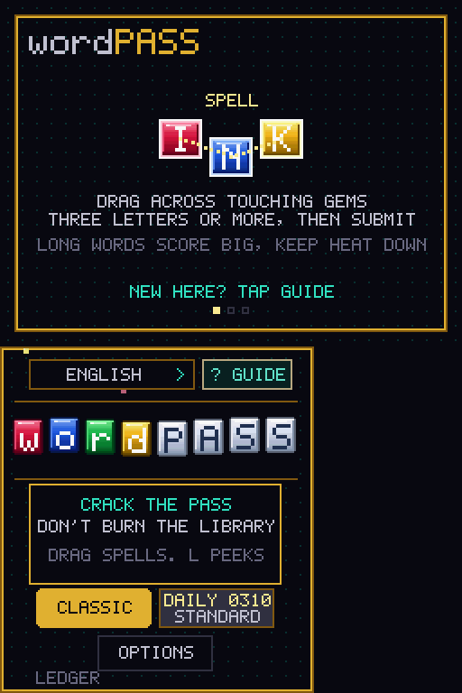
*The title screen. The top screen turns three tip cards; the touch screen has CLASSIC, the Daily button, OPTIONS and the GUIDE button.*

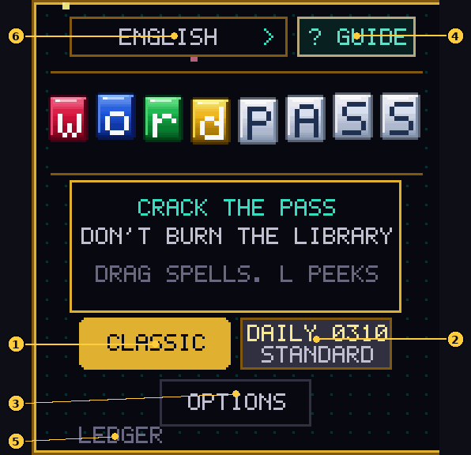
*The title buttons. 1 CLASSIC, 2 the Daily Pass button (it shows the date and the day's modifier), 3 OPTIONS, 4 the pulsing ? GUIDE
button (it pulses until you have finished your first guided shelf), 5 the BEST / LEDGER line, which opens the lifetime statistics, 6 the language tag (tap it for the next language; section 14).*

### The first shelf, step by step

**1. Start.** Tap **CLASSIC** (or press **START** or **A**). The first Classic shelf is *guided*: sticky prompts on the top
screen tell you what to do next, and a ghost stylus shows a real word on your real board if you wait three seconds.

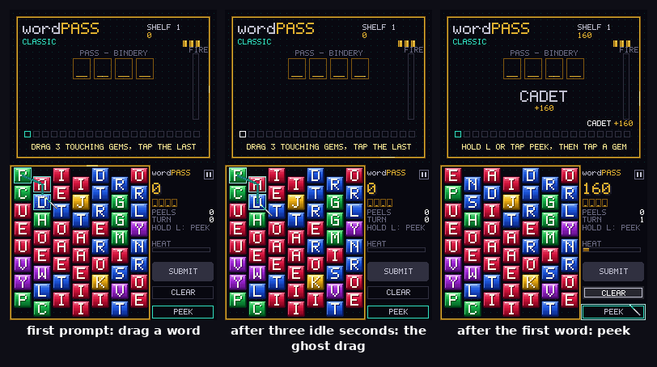
*The guided first shelf. Left: "DRAG 3 TOUCHING GEMS, TAP THE LAST". Middle: after three idle seconds a ghost stylus traces a real word. Right: after your first word the prompt asks you to peek, and the PEEK button gets a ring.*

**2. Read the screen.** The top screen says what you are looking for: `PASS - BINDERY`, and four empty slots. The pass is a four-letter
word from the BINDERY theme (book words) and every slot will fill with a diamond as you find its letter. The touch screen is the
board: seven columns of eight gems.

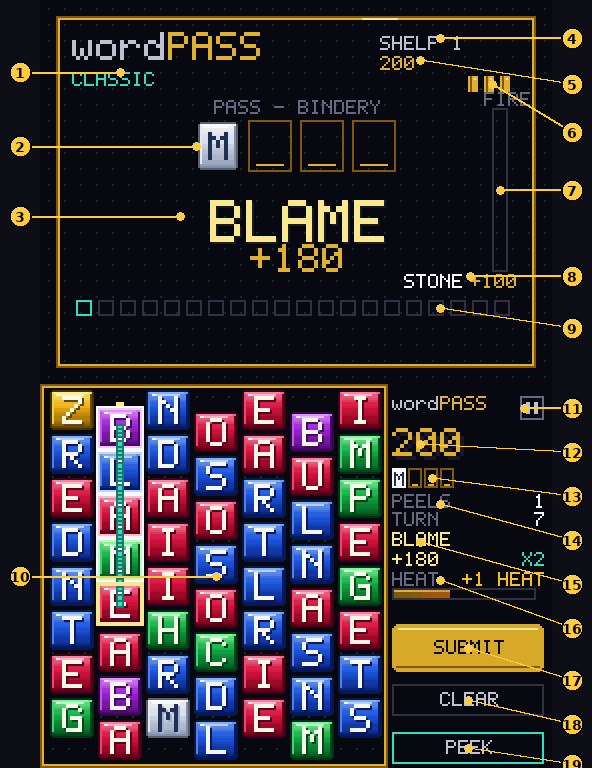
*Everything on the play screen. Top screen: 1 the mode (CLASSIC, LOCKDOWN, DAILY), 2 the pass plaque (one slot per letter; a found letter turns into a diamond), 3 the word you are building, large, with what it is worth, 4 the shelf number, 5 your score, 6 bookmarks, 7 the fire meter (it fills down to the lowest flame), 8 the ledger of your last words, 9 the shelf map. Touch screen: 10 the board, 11 the pause button, 12 the score, 13 the pass tracker, 14 PEELS and TURN, 15 the chain's word and value, 16 the HEAT line and heat bar, 17 SUBMIT, 18 CLEAR, 19 PEEK.*

**3. Spell a word.** Press the stylus on a gem and drag across **touching** gems. Every gem you cross joins the chain, and a rope
links them. You need at least **three gems**. When the chain spells a real word the rope turns the shelf's accent colour, the
last gem wears a gold ring and the panel shows what the word is worth and how much heat it will add.

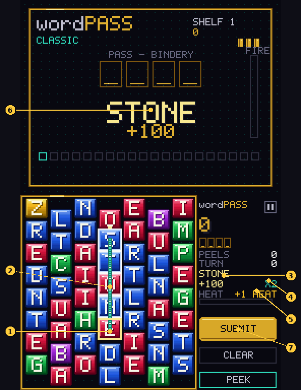
*A valid chain. 1 the gold ring on the last gem (tap it to submit), 2 the rope in the accent colour (it was gold while the word was not yet valid), 3 the word on the panel, 4 the length multiplier, 5 the heat the word will add, 6 the word and its value on the top screen, 7 SUBMIT glows.*

**4. Submit it.** Tap the gold-ringed last gem again, or tap **SUBMIT**, or press **A**. The gems shatter, the column drops, new
gems fall in, and the word scores. Every word is a **turn**.

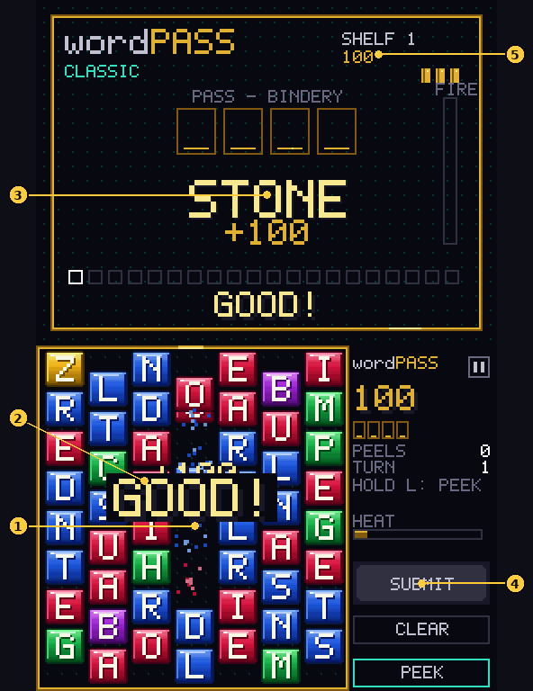
*The submit moment: 1 shards of the gems you used, 2 the GOOD! callout, 3 the word and its points on the top screen, 4 the SUBMIT button flashing white, 5 the score has gone up.*

**5. Peek.** Hold **L** or **R** (either shoulder; the game suggests the one under your idle hand), or press **X** or tap **PEEK** to latch peek on for one peel. The gems dim to outlines. Touch a gem to *arm* it (a double rim and a PEEL label), and **lift the stylus** to peel it off the board. If you change your mind, slide off the gem before you lift.

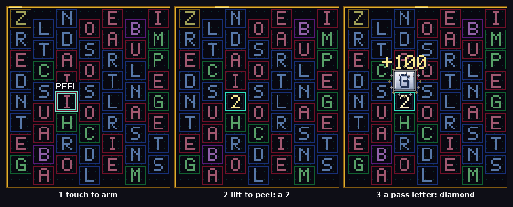
*A peel in three steps. 1 Touching a gem in peek mode only arms it. 2 Lifting the stylus peels it: the cell is now a hole showing a **2**: two of its six neighbours hide pass letters. 3 Peeling a gem that does hide a pass letter turns it into a diamond and pays +100 on shelf 1.*

**6. Find the pass.** A peeled gem leaves a hole showing a number: how many of the **six cells around it** hide a pass letter.
Zero means none of them do. A peeled gem that hides a letter becomes a **diamond** and pays **100 × shelf** points on the spot.
Find every letter and the shelf is cleared. Section 6 teaches the whole art of reading the numbers.

**7. Watch the fire.** Short words and every peel warm the shelf (the HEAT bar on the panel). When it fills, the top gem of a
column catches fire and slowly creeps down. Put a flame out by spelling a word **through** it. Never peel a gem directly under a
flame: the back layer burns and a pass letter hidden there is gone for good.

**8. Collect.** Clearing a shelf shows the results card: your best word, the shelf bonus, a speed bonus for each turn you saved and a
PERFECT or CLEAN PASS bonus for tidy peeling. Tap to continue to the next shelf, a little harder every time.

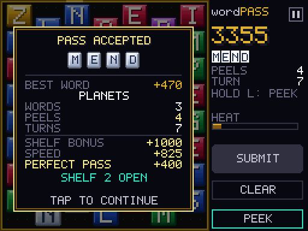
*A results card: three words, four peels, seven turns, a perfect pass. Section 5 does this arithmetic line by line.*

That is the whole game. The rest of this guide explains every rule exactly, then how to play well.

---

## 2. Screens and controls

### 2.1 The screens

| Screen | How you get there | What it is |
| --- | --- | --- |
| Title | on boot, or quitting a run | CLASSIC, Daily, OPTIONS, GUIDE, LEDGER |
| Play | CLASSIC or the Daily button | the shelf |
| Pause | START or the II button on the panel | RESUME, RESTART SHELF, HOW TO PLAY, QUIT TO TITLE |
| Results card | the last pass letter is found | bonuses and stats; tap to go on |
| Fail card | a shelf is lost | why, the pass revealed, stats; tap to retry |
| Options | OPTIONS or Y on the title | nine settings |
| The Ledger | the BEST line or X on the title | lifetime statistics |
| HOW TO PLAY | the GUIDE button or B on the title, or the pause menu | eight animated pages |

### 2.2 Every control

<!-- check:controls -->
| Input | Where | Action |
| --- | --- | --- |
| **Stylus drag** | play | chain letters across touching gems; drag back onto the previous gem to undo one |
| **Stylus tap on the last gem** | play, chain of 3 or more | submit (a valid word wears a gold ring; an invalid one is refused with a message) |
| **Stylus tap on an earlier gem** | play | cut the chain back to that gem |
| **Stylus tap on a gem away from the chain** | play | start a new chain there |
| **SUBMIT button** | play | submit the chain |
| **CLEAR button** | play | clear the chain |
| **A** | play | submit the chain; with the d-pad cursor shown, chain the gem under the cursor, and submit when the cursor is on the tail of a chain of 3 or more |
| **B** | play | step the chain back one gem; hold for 20 frames (a third of a second) to clear it |
| **Y** | play | clear the chain at once |
| **D-pad** | play | move the hex cursor (up, down, left, right; it steps half a gem when the column changes parity) |
| **L or R** (hold) | play | peek: touch a gem to arm it, lift to peel it, slide off to cancel |
| **X** | play | latch peek on for one peel; press again to cancel; with the cursor shown, **A** then peels the gem under it |
| **PEEK button** | play | the same latch as X |
| **START** | play | pause |
| **II button** | play | pause |
| **SELECT** | play | nothing (it starts the Daily on the title only) |
| **Stylus tap on a menu row** | pause | tap a row to light it, tap the lit row to pick it |
| **D-pad up and down** | pause | move the highlight; **A** picks it; RESTART and QUIT ask for a second pick within 90 frames |
| **START or B** | pause | resume |
| **Stylus, A or START** | results card | continue (after about half a second) |
| **Stylus, A or START** | fail card | retry, or go to the title when no bookmark is left (after about three quarters of a second) |
| **Stylus** | title | the buttons: CLASSIC, the Daily button, OPTIONS, GUIDE, and the BEST line for the Ledger |
| **START or A** | title | Classic |
| **SELECT** | title | Daily Pass |
| **Y** | title | options |
| **X** | title | the Ledger |
| **B** | title | HOW TO PLAY |
| **LEFT or L, RIGHT or R** | title | flip the tip cards |
| **Stylus** | options | tap the left half of a row to step its value back and the right half to step it forward; BACK leaves |
| **D-pad, A, B** | options | up and down pick a row, left and right change it, **A** steps forward, **B** leaves |
| **B, X, A, START or a tap** | the Ledger | close it |
| **LEFT or RIGHT, L or R, A, the buttons, the page dots** | HOW TO PLAY | turn pages (they wrap; A on the last page closes) |
| **B, START or BACK** | HOW TO PLAY | return to the title or the pause menu |

*Frames are 1/60 of a second.* A flick of the stylus is forgiving: a gem answers to a 12-pixel circle around its centre, a quick
flick that skips a gem still picks it up when exactly one gem could have been crossed, and a drag never restarts your chain by
accident: a gem it cannot reach flashes red instead.

### 2.3 The two hands

HAND (in the options) mirrors the **touch layout**: the board and the panel swap sides, and the title's buttons mirror with them.
The **top screen never mirrors**, and the options list never mirrors (so changing HAND never moves a row from under your stylus).

| | Right hand | Left hand |
| --- | --- | --- |
| Board | the left 172 pixels (x 4 to 172) | the right 172 pixels (x 86 to 254) |
| Panel (score, PEEK, SUBMIT, CLEAR) | the right 76 pixels (x 176 to 252) | the left 76 pixels (x 4 to 80) |
| Peek hint on the panel | HOLD L: PEEK | HOLD R: PEEK |
| The HOW TO PLAY BACK corner | top right | top left |

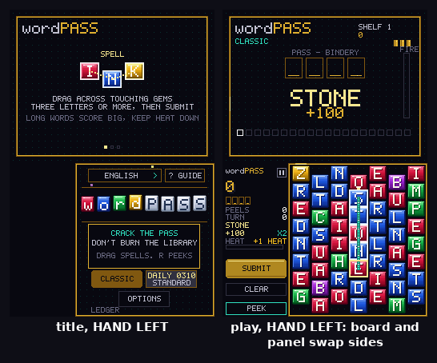
*HAND LEFT: the title (left pair) and a shelf in play (right pair). The top screen is identical in both hands.*

### 2.4 Playing with buttons only

The whole game plays without the stylus. Press the d-pad and a **cursor** appears on the board: a two-pixel rim that alternates white and the accent colour, with a notch above it. Up and down move it a row,
left and right a column. **A** chains the gem under the cursor (it has to touch the tail of your chain: a flash of red says it does not), and **A** on the tail of a chain of three or more submits it. **B** takes the last gem back, **Y** clears, **X** latches peek and **A** on the cursor then peels that gem straight away. Under a flame the cursor's rim turns amber while you are peeking. Touch the screen and the cursor goes away and the stylus takes over again.

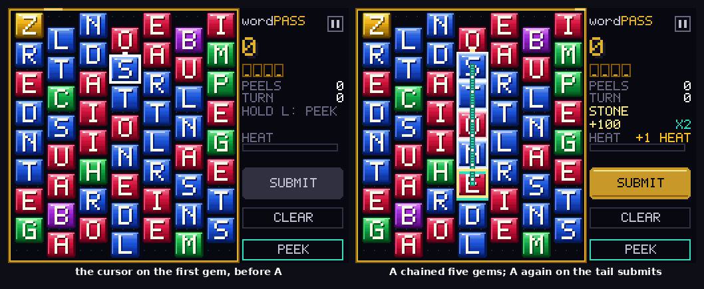
*Button play. Left: the cursor on the first gem. Right: five presses of A (with DOWN between them) chained STONE; the cursor sits on the tail, and one more A submits it.*

### 2.5 The pause menu

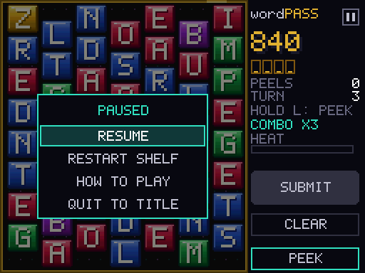
*The pause menu. The board dims in hardware. RESTART SHELF costs a bookmark and QUIT TO TITLE ends the run, so each asks for a second pick within 90 frames ("TAP AGAIN TO QUIT"). RESTART is refused on your last bookmark ("LAST BOOKMARK"), and the Daily Pass has no RESTART row at all.*

### 2.6 The in-game guide

The game has its own eight-page, animated manual: **HOW TO PLAY**. Open it from the title (the **? GUIDE** button or **B**) or from the pause menu. The touch screen holds the words and the top screen plays a four-second looping story per page, drawn with the board's own gems, holes, flames and diamonds. Every number on a page is printed from the same tables the rules use. The eight pages are shown below.

<details>
<summary>The eight pages of HOW TO PLAY (click to open)</summary>

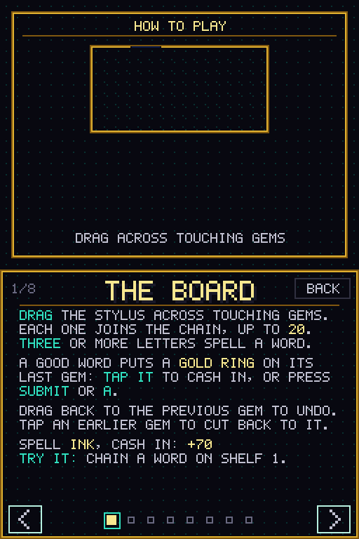
*Page 1, THE BOARD: dragging a chain, the gold ring, tapping the last gem, undo and cut back.*

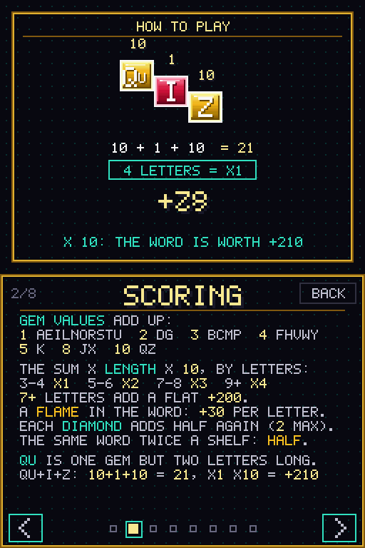
*Page 2, SCORING: gem values, the length multipliers, the flat bonus for seven letters, flames, diamonds and repeats.*

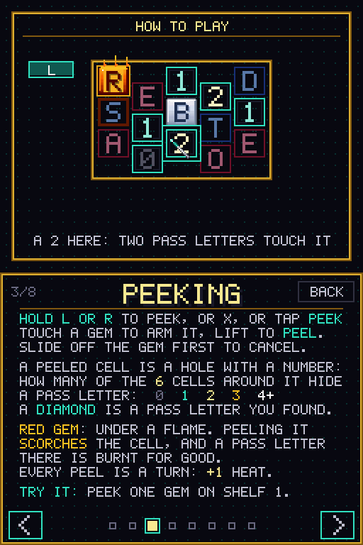
*Page 3, PEEKING: the buttons, the numbers and their colours, diamonds, and the red gems that scorch.*

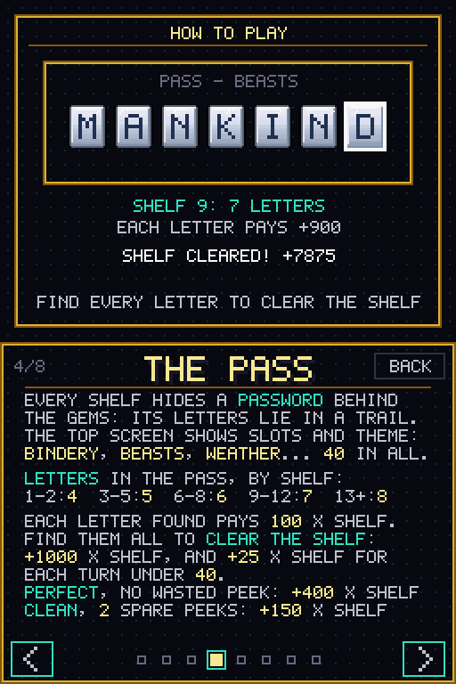
*Page 4, THE PASS: hidden letters, the themes, the pass length by shelf, and what each letter and the shelf pay.*

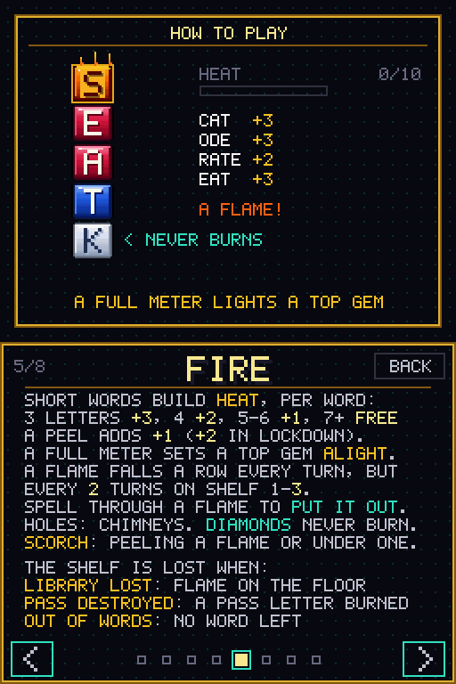
*Page 5, FIRE: the heat each word adds, how a flame falls, chimneys and firebreaks, and the three ways to lose a shelf.*

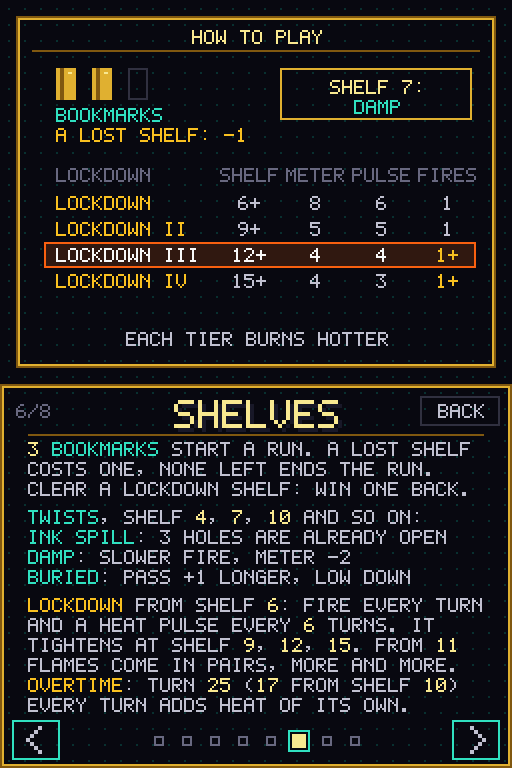
*Page 6, SHELVES: bookmarks, the three twists, Lockdown and its tiers, overtime.*

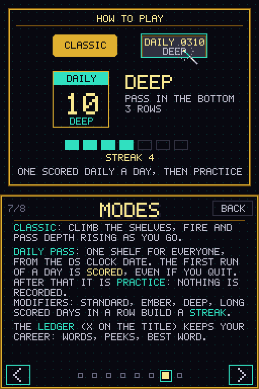
*Page 7, MODES: Classic, the Daily Pass and its modifiers, the Ledger.*

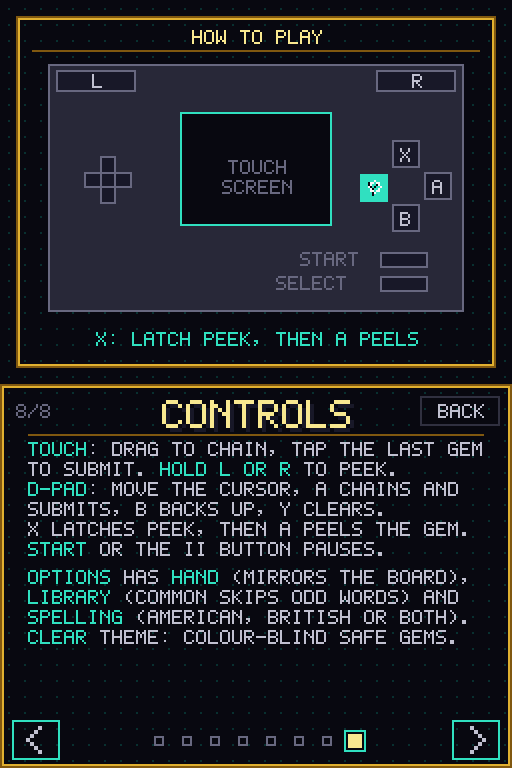
*Page 8, CONTROLS: touch, d-pad, buttons, and the options that matter.*

</details>

---

## 3. The board

The board is **7 columns by 8 rows** of gems (56 in all). Each gem is 24 pixels wide and 22 tall. Columns are numbered 0 to 6 from the
left of the board and rows 0 to 7 from the top.

### 3.1 The hex grid

The grid is a hexagonal grid drawn with rectangles: **odd columns (1, 3 and 5) drop half a gem** (11 pixels). Two gems are neighbours when
they touch across a flat side or across the half-gem step. A gem has up to six neighbours: the one above, the one below, and two on each side.

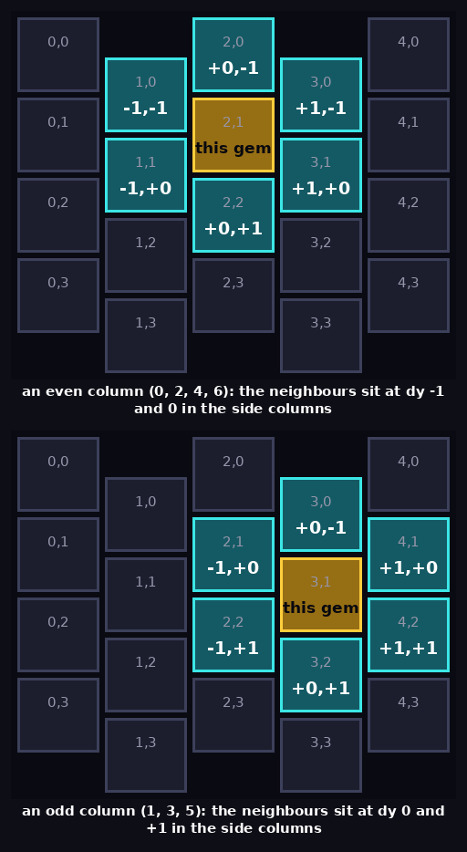
*Adjacency. In an even column (0, 2, 4, 6) the neighbours in the side columns are one row up and level; in an odd column (1, 3, 5), which sits half a gem lower, they are level and one row down. The labels give each neighbour's offset in (columns, rows).*

<!-- check:neighbours -->
| Column | Neighbours as (dx, dy) |
| --- | --- |
| even: 0, 2, 4, 6 | (0, -1) (0, +1) (-1, -1) (-1, 0) (+1, -1) (+1, 0) |
| odd: 1, 3, 5 | (0, -1) (0, +1) (-1, 0) (-1, +1) (+1, 0) (+1, +1) |

Gems on the edges have fewer neighbours: a corner gem has two or three, any other edge gem three to five. This matters for peeking: a number can never be larger than the
number of neighbours the cell has (section 6.4).

### 3.2 What is on the board

| Thing | What it is | Chainable | Burns | Falls |
| --- | --- | --- | --- | --- |
| **Gem** | a plain letter gem | yes | yes | yes |
| **Flame** (a burning gem) | a gem on fire; it creeps down the column | yes (a word through it puts it out) | it is the fire | no: it hangs where it is |
| **Hole** | a peeled gem; shows a number for the rest of the shelf | no | no (fire falls straight through it) | no |
| **Diamond** | a pass letter you found | yes | **never** | no |
| **Qu gem** | one gem that holds the two letters Qu | yes | yes | yes |

**Gems.** Every gem carries a letter and a colour by letter group. In the default JEWEL theme vowels (A E I O U) are **ruby**, the common consonants (R S T L N D) are **sapphire**, the
awkward ones (J K Q X Z) are **amber**, the middle ones (V W Y F B) **amethyst**, and the rest (C G H M P) **emerald**. The colour is only a hint: the letter is what counts. In the CLEAR theme the groups are yellow, blue, magenta, teal and grey.

**Flames.** A burning gem has a light plate under a dark letter, a bright bar across its top and tongues that rise over its edge, in every theme, so it can never be mistaken for a plain gem even without colour.

**Holes.** A hole is what is left when you peel a gem. It shows the number you peeled for, in a colour: 0 grey, 1 the accent colour, 2 gold, 3 amber, 4 and above white. It stays for the whole shelf. The cells above a hole do not fall into it, and the cells below it refill from behind it (section 3.3).

**Diamonds.** A diamond is a pass letter you have found. It shows the letter, you can chain through it (that is the *PASS LINK*), it can never burn, it stays put when a word uses it, and it blocks fire. It is both a stepping stone and a firebreak.

**The Qu gem.** There is no bare Q on the board: the Q gem is **Qu**, one gem, worth **10** points and two letters long. A word through it spells *qu*: QUIZ is the chain Qu, I, Z, three gems and four letters, so it counts as a four-letter word for the multiplier, the heat and the dictionary. The chain minimum (three gems) counts gems, not letters.

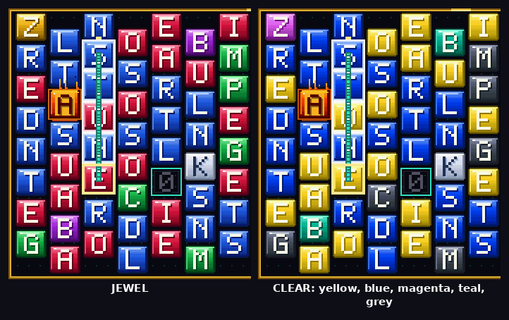
*The JEWEL theme (left) and CLEAR (right): the same board, the same chain, a flame, a diamond and a hole. CLEAR is built for colour blindness: its five groups differ in lightness as well as hue.*

### 3.3 Gravity

When gems leave, the ones above fall. **Holes, diamonds and flames are floors:** they split a column into segments. Gems fall within their segment, and every segment refills from its top, so the gems below a hole come back too (they drop in from behind the separator). Two consequences:

* A flame *hangs where it is* when you clear the gems under it. Fire moves only on the fire clock (section 8), never because you cleared something.
* A diamond or hole never moves, however many words you spell around it.

The letters come from a shuffled **bag of 100** drawn without replacement, so a shelf never starves of vowels or drowns in them: J, Q, X and Z share two slots per bag (at most two of them per bag), and a column that refills with three or more consonants and no vowel gets a vowel in its lowest new gem. A shelf's board, its refills and its fire come from one random stream per shelf, which is why two players on the same Daily see the same game (section 10).

---

## 4. Making words

### 4.1 Chain rules

* A chain is **3 to 20 gems** (`MAX_CHAIN`). A Qu gem counts as one gem but two letters, so a 20-gem chain can spell up to 40 letters; the longest word the dictionary holds is 20 letters.
* Every gem must **touch** the one before it (section 3.1) and you may not use a gem twice.
* **Backtrack:** drag back onto the previous gem to drop the last one. B does the same from the d-pad.
* **Cut back:** tap an earlier gem of the chain to cut the chain back to it (a tap only; a drag across your own chain does nothing).
* **Bridge:** if the stylus is fast enough to skip a gem, the game fills it in when there is exactly one gem that touches both the tail and the gem you reached. If there are two possible gems it does not guess: a drag that cannot be explained flashes the gem red and does nothing.
* **Restart:** a tap on a gem away from the chain starts a new chain there. A drag never restarts: it can only extend, backtrack or bridge.
* Submit by tapping the tail again (chain of at least three), SUBMIT, or A. Peeking switches chaining off while you hold the shoulder button.

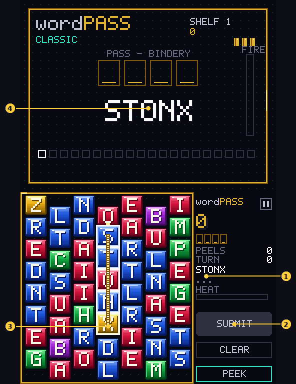
*A chain that spells nothing. 1 the panel shows `...` instead of a value, 2 SUBMIT stays dark, 3 no gold ring on the tail, 4 the word on the top screen is white, not gold. You can still try to submit it; the game will say why it was refused.*

### 4.2 The dictionary

The dictionary holds **183,419 words of 3 to 20 letters**, in two tiers:

* **Common** (23,497 words): everyday words, the ENABLE words that appear in the top 30,000 of a frequency list or in the Google 10,000 list.
* **Rare** (159,922 words): everything else in the dictionary, including real but obscure words (ZAX, for one). A rare word scores like any other, it can pop the callout **RARE WORD** (section 5.3) and it counts in the Ledger.

Under **LIBRARY: FULL** (the default) both tiers are accepted. Under **LIBRARY: COMMON** a rare word is refused (**TOO OBSCURE**), which is a gentler game: only about 13 in 100 dictionary words are accepted.

The full table of word counts by length is in the appendix.

### 4.3 SPELLING and the -ize / -ise forms

The SPELLING option decides what happens to words that are spelled differently in American and British English:

* **BOTH** (default): either spelling is accepted: COLOR and COLOUR.
* **AMERICAN**: words spelled only the British way (COLOUR, CENTRE, TRAVELLED, GREY) are refused with **BRITISH SPELLING**: *that is the British spelling*.
* **BRITISH**: words spelled only the American way (COLOR, CENTER, TRAVELED, GRAY) are refused with **AMERICAN SPELLING**.

Words spelled the same everywhere are always accepted, and so are the **-ize and -ise** forms: ORGANIZE and ORGANISE are both accepted under every setting, because both are correct in British usage. The variant list (`data/variants.bin`, 1,301 American-only and 1,197 British-only words) comes from the US and GB Hunspell dictionaries plus a few spelling rules. Here is what the game does with a few of them:

<!-- check:variants us=1301 uk=1197 -->
<!-- check:spelling-probes -->
| Word | BOTH | AMERICAN | BRITISH |
| --- | --- | --- | --- |
| `color` | yes | yes | no |
| `colour` | yes | no | yes |
| `center` | yes | yes | no |
| `centre` | yes | no | yes |
| `organize` | yes | yes | yes |
| `organise` | yes | yes | yes |
| `traveled` | yes | yes | no |
| `travelled` | yes | no | yes |
| `grey` | yes | no | yes |
| `gray` | yes | yes | no |
| `tour` | yes | yes | yes |
| `zax` | yes | yes | yes |

### 4.4 Why was my word refused?

Try to submit a chain of three or more gems and the game either scores it or tells you why not. (A chain of one or two gems does nothing.) The reason shows on the top screen and as a short callout over the board, and the chain flashes red and shakes.

<!-- check:messages -->
| Message | When |
| --- | --- |
| `NOT IN THE LIBRARY` | the letters are not a word in the dictionary (callout NOT A WORD) |
| `TOO OBSCURE` | a rare word under LIBRARY: COMMON |
| `AMERICAN SPELLING` | an American-only spelling under SPELLING: BRITISH (callout US SPELLING) |
| `BRITISH SPELLING` | a British-only spelling under SPELLING: AMERICAN (callout UK SPELLING) |

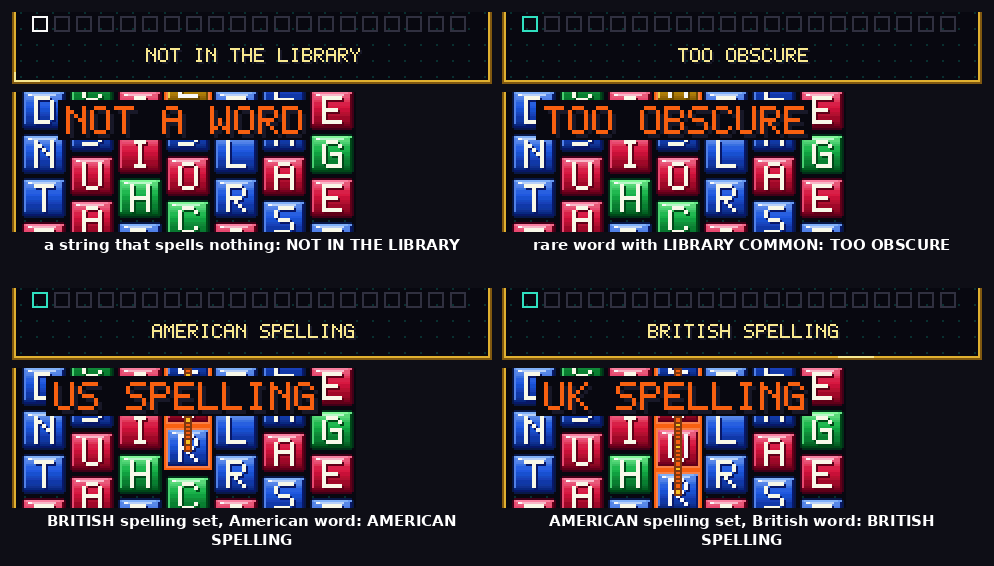
*The four refusals. The top screen carries the full reason; the board callout is short enough to pop at double size.*

### 4.5 Repeats and the ledger

The shelf remembers the last **eight** words you spelled (the ledger; the top screen shows the last five). Spelling a word that is **in the ledger** again halves its score and calls out **AGAIN**. The comparison is on the whole word, so a repeat is found whatever its length.

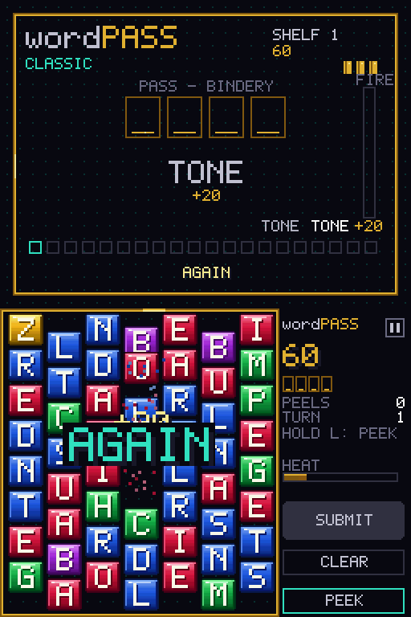
*A repeat: TONE twice. The second time it scored half of the first, and the callout said AGAIN.*

The ledger belongs to the shelf: a new shelf starts with an empty one. A word that leaves the ledger after eight others can be spelled at full value again.

### 4.6 Long words

Long words are the best deal in the game: from **seven letters** a word adds a flat **+200**, from **nine letters** the multiplier is x4, and from seven letters up a word adds **no heat at all**.

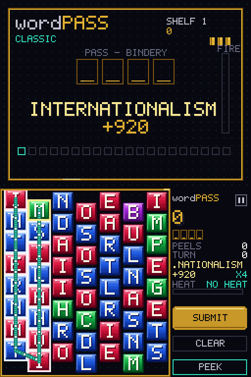
*A 16-gem chain. The panel shows the last eleven letters (a dot says there are more), the top screen shows the whole word at double size (words over 13 letters switch from triple to double size), and the panel's value line shows +920 and X4.*

---

## 5. Scoring, exactly

### 5.1 What a word is worth

A word scores in four steps, in this order:

1. **Letter values.** Add up the values of the gems in the chain (the table below). A Qu gem is worth 10.
2. **Length multiplier.** Multiply by the multiplier for the word's **letter** count (the table below), then by **10**.
3. **Bonuses.** Add a flat **200** if the word has **7 letters or more**. Add **30 per letter** if the word goes through a **burning gem**.
4. **Diamonds.** Each **diamond** in the chain adds **half of the total so far** (at most two count): one diamond is x1.5, two diamonds are x2.

Finally, a word that is **already in the shelf's ledger** is **halved** (rounded down). All divisions round down.

<!-- check:values -->
| Value | Letters |
| --- | --- |
| 1 | A E I L N O R S T U |
| 2 | D G |
| 3 | B C M P |
| 4 | F H V W Y |
| 5 | K |
| 8 | J X |
| 10 | Q Z |

(The gem Q is *Qu*, worth 10 for the pair.)

<!-- check:lenmult -->
| Letters | Multiplier |
| --- | --- |
| 3 to 4 | x1 |
| 5 to 6 | x2 |
| 7 to 8 | x3 |
| 9 and up | x4 |

A Qu gem counts as two letters here, so the chain Qu, I, Z (QUIZ) is a four-letter word: x1.

### 5.2 Three worked examples

**INK.** I = 1, N = 1, K = 5: a total of 7. Three letters: x1. 7 × 1 × 10 = **+70**.

<!-- check:example name=ink base=7 len=3 burn=0 diamonds=0 repeat=0 expect=70 -->

**QUIZ.** Qu = 10, I = 1, Z = 10: a total of 21. Four letters: x1. 21 × 1 × 10 = **+210**.

<!-- check:example name=quiz base=21 len=4 burn=0 diamonds=0 repeat=0 expect=210 -->

**LANTERN through a flame and a diamond.** L, A, N, T, E, R, N are 1 each: a total of 7. Seven letters: x3. 7 × 3 × 10 = 210. Seven letters or more: +200 = 410. The E was burning: +30 × 7 letters = +210 = 620. The A was a diamond: half of 620 again is +310 = **+930**.

<!-- check:example name=lantern base=7 len=7 burn=1 diamonds=1 repeat=0 expect=930 -->

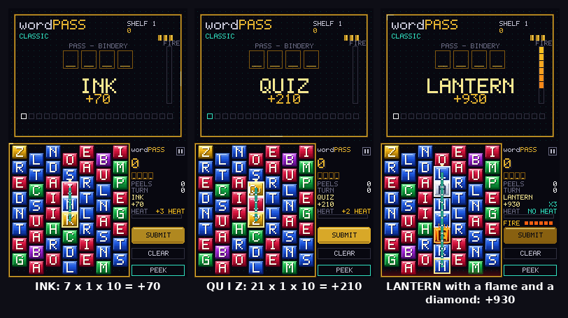
*The three examples held on a real board. The panel and the top screen price each chain exactly as worked above.*

The same arithmetic the native tests check, for a few more shapes (a letter total of 10 on a seven-letter word, 5 on a four-letter word):

| Shape | Working | Points |
| --- | --- | --- |
| total 10, seven letters | 10 × 3 × 10 + 200 | 500 |
| total 5, four letters, through a flame | 5 × 1 × 10 + 30 × 4 = 50 + 120 | 170 |
| total 5, four letters, two diamonds | (5 × 1 × 10) x 2 | 100 |
| total 5, four letters, a repeat | (5 × 1 × 10) / 2 | 25 |

<!-- check:example name=seven base=10 len=7 burn=0 diamonds=0 repeat=0 expect=500 -->
<!-- check:example name=flame4 base=5 len=4 burn=1 diamonds=0 repeat=0 expect=170 -->
<!-- check:example name=two-diamonds base=5 len=4 burn=0 diamonds=2 repeat=0 expect=100 -->
<!-- check:example name=repeat base=5 len=4 burn=0 diamonds=0 repeat=1 expect=25 -->

A third diamond adds nothing: only two count. The diamonds stay on the board after the word, so the same two diamonds can lift a *different* word again and again (a repeat is still halved).

### 5.3 Callouts

Every scored word gets at most one callout, the first of these that applies:

<!-- check:callouts -->
| Callout | When |
| --- | --- |
| `SPECTACULAR!` | a word of 8 letters or more |
| `PASS LINK!` | a word through at least one diamond |
| `EXCELLENT!` | a word of 7 letters |
| `GOOD!` | a word of 5 or 6 letters |
| `AGAIN` | a repeat of 4 letters or fewer |
| `RARE WORD` | a rare-tier word of 4 letters or fewer, not a repeat |

### 5.4 Pass letters, the shelf, speed and the peel bonus

Peeling a pass letter pays at once, and clearing the shelf pays three more things:

<!-- check:bonuses -->
| Bonus | Per shelf number |
| --- | --- |
| Pass letter found | 100 |
| Shelf cleared | 1000 |
| Speed, for every turn under 40 | 25 |
| PERFECT PASS (every peel found a pass letter) | 400 |
| CLEAN PASS (at most two wasted peels) | 150 |

Multiply each by the **shelf number**. On shelf 3: 300 per letter, 3000 for the shelf, 75 per turn under 40, 1200 for a perfect pass.

* **Speed** pays for turns *under 40* and counts words **and** peels; from turn 40 on it is zero.
* **PERFECT PASS** is `peels == the pass length`: every peel was a pass letter. **CLEAN PASS** is `peels <= pass length + 2`. One or the other, never both.
* The bonuses are added the moment the last letter is found. The pass letters themselves were paid as you found them.

### 5.5 The results card, line by line


*The card from the quick start. The run behind it: three words (STONE, GARDEN and PLANETS), four peels that all found a letter, seven turns.*

| Line | What it shows |
| --- | --- |
| PASS ACCEPTED | the title (it names the twist on a twist shelf; the Daily says DAILY PASS DONE or PRACTICE DONE) |
| the diamonds | the pass; the letters light one at a time |
| BEST WORD | the best-scoring word of the shelf, and its points |
| WORDS | words spelled this shelf; `3 (2 UNIQUE)` when some were repeats |
| PEELS | peels used: gold when perfect, accent colour when clean |
| TURNS | words plus peels |
| SHELF BONUS | 1000 × shelf |
| SPEED | 25 × shelf × (40 − turns), never below zero |
| PERFECT PASS / CLEAN PASS / PEEL BONUS | the peel bonus, or a dash |
| SHELF n OPEN | the next shelf (the Daily says FINAL and your score) |

The score on the panel counts up from the score before the bonuses, filling the three bonus rows in order (shelf, speed, peel). A tap skips to the end. A blinking **NEW BEST** says the run beat a saved record.

Worked, for that card: the words scored 100 (STONE: 5 × 2 × 10), 160 (GARDEN: 8 × 2 × 10) and 470 (PLANETS: 9 × 3 × 10 + 200), a total of 730. The four pass letters paid 4 × 100 = 400 as they were found. Then 1000 for the shelf, 25 × 1 × (40 − 7) = 825 for speed and 400 × 1 for a perfect pass: 730 + 400 + 1000 + 825 + 400 = **3355**, the number on the panel.

<!-- check:example name=stone base=5 len=5 burn=0 diamonds=0 repeat=0 expect=100 -->
<!-- check:example name=garden base=8 len=6 burn=0 diamonds=0 repeat=0 expect=160 -->
<!-- check:example name=planets base=9 len=7 burn=0 diamonds=0 repeat=0 expect=470 -->
<!-- check:bonus shelf=1 turn=7 peels=4 len=4 reward=100 shelfb=1000 speed=825 peel=400 kind=2 -->
<!-- check:bonus shelf=3 turn=8 peels=5 len=5 reward=300 shelfb=3000 speed=2400 peel=1200 kind=2 -->

---

## 6. Peeking, the heart of the game

Under the gems there is a second layer, the **back layer**, and on it the letters of the pass. Peeking is how you read it.

### 6.1 How to peel

1. **Peek on.** Hold **L** or **R**, or latch it with **X** or the **PEEK** button. The gems dim to outlines with their letters still readable, so the layer you are reading is always the one in colour.
2. **Arm.** Touch a gem. It gets a pulsing double rim and a **PEEL** label.
3. **Lift** the stylus. The gem is peeled. To cancel, slide off the gem (or onto another gem) before you lift: nothing happens.

A latched peek (X or the button) is **one-shot**: it clears itself after a peel. Press X again to cancel it before. On the d-pad, X then **A** peels the gem under the cursor at once.

Only plain gems and flames can be peeled; you cannot peel a hole or a diamond.

### 6.2 What a peel costs

**Every peel is a turn** and it warms the shelf: **+1 heat** (**+2 in Lockdown**), plus any Lockdown pulse and overtime heat that turn adds (section 8). A peel does not score by itself, and any chain you were holding is dropped.

A peel can have three outcomes:

* **A pass letter:** the gem becomes a **diamond**, **+100 × shelf** points, the plaque on the top screen pops open the letter.
* **A plain gem:** the cell becomes a **hole** showing a **number**.
* **A scorch** (section 6.7): the cell becomes a hole with a burnt rim, or the run of the shelf ends.

If the peel finds the **last** pass letter, the shelf is cleared at once, even when that turn's heat would have lit a flame or the fire would have reached the floor.

### 6.3 What a hole digit means

A hole shows **how many of the six cells around it hide a pass letter**. Cells are neighbours as in section 3.1, so you count the six cells that touch it: the one above, the one below and two on each side.

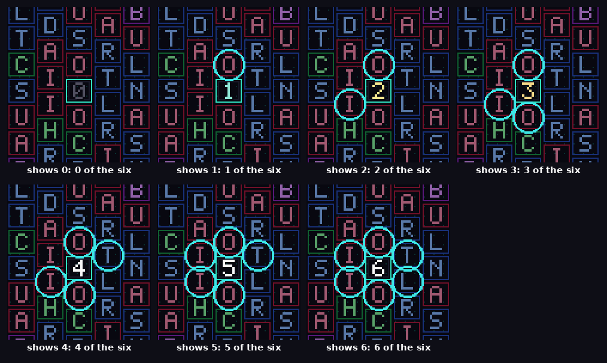
*The numbers 0 to 6 for the same cell. The rings are added for the picture: the game never shows where the pass letters are. A 0 means none of its six neighbours is a pass letter; a 6 means all six are.*

Three things to remember:

* The number counts **every pass letter that touches the hole, including ones you have already found** (diamonds). A found letter does not stop counting. When you read a number, subtract the diamonds you can see around the hole.
* The number counts the letters in the **unpeeled neighbours**. A neighbour that you have peeled and that did not turn into a diamond has no letter: it is safe.
* The colour is only decoration: 0 grey, 1 the accent colour, 2 gold, 3 amber, 4 and up white.

### 6.4 Edges and corners

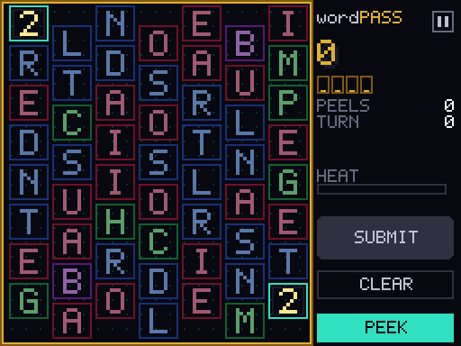
*A hole in the top-left corner has two neighbours, so its number is 0, 1 or 2, never more. An edge hole has three to five.*

A cell in a corner has **two or three** neighbours, an edge cell **three to five**, an inner cell six. A number can never be larger than the cell's neighbour count. On an edge the same number is stronger evidence: a **1** in a corner has two candidates, a 1 in the middle of the board has six.

### 6.5 Reading one, two and three numbers together

A single number rarely tells you where the letter is. The numbers become powerful together. These puzzles are drawn from a real board; the solver in `tools/emu/screens.py` proves that each has exactly one answer.

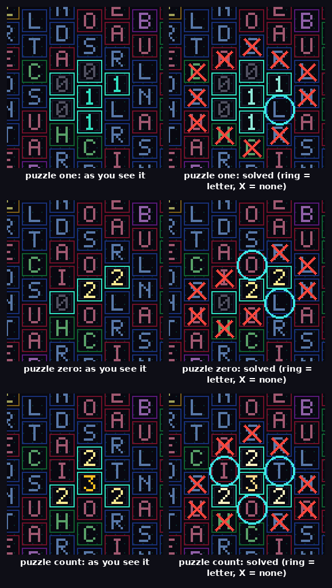
*Three puzzles. Left: what is on the board. Right: the solution; rings are pass letters, crosses are cells that cannot hold one.*

**Puzzle 1: the last neighbour.** The middle hole (column 3, row 3) shows **1**. Its six neighbours are (3,2), (3,4), (2,3), (2,4), (4,3) and (4,4). Five of them are already holes. A hole holds no letter, so the one pass letter around the **1** must be in the sixth cell, (4,4). *Rule: a number minus the letters you already know, with only one unpeeled neighbour left, names that neighbour.*

**Puzzle 2: a zero clears the way.** Three holes: (3,3) shows **2**, (4,3) shows **2**, and (2,4) shows **0**. The **0** says that none of its six neighbours, (2,3), (2,5), (1,3), (1,4), (3,3) and (3,4), hides a letter. Now look at the **2** at (3,3): its neighbours are (3,2), (3,4), (2,3), (2,4), (4,3) and (4,4). (2,4) and (4,3) are holes, and the **0** just cleared (3,4) and (2,3). That leaves only (3,2) and (4,4), and the **2** needs two letters: **both are pass letters**. The second **2**, at (4,3), agrees: (3,2) and (4,4) are two of its neighbours. *Rule: a zero is a safe zone. Peel zeros and their neighbours first.*

**Puzzle 3: the number equals the count.** The hole at (3,3) shows **3**. Its neighbours are (3,2), (2,4) and (4,4), which are holes, and (3,4), (2,3) and (4,3), which are still gems. Three letters to place among three gems: **all three are pass letters**. The three **2**s agree: each of those holes touches exactly two of them. *Rule: when the number equals the number of unpeeled neighbours, they are all letters.*

Two more rules come from reading two numbers that share neighbours:

* **Overlap.** If a **1** has the unpeeled neighbours {x, y} and a neighbouring **2** has {x, y, z}, then z is a letter (the 2 needs one more than the 1 can explain) and exactly one of x and y is a letter.
* **Subtraction.** Take a number, subtract the diamonds touching it and the letters you have deduced: what is left must come from the remaining unpeeled neighbours.

### 6.6 Risk and what a peel is worth

Every peel costs a turn and a point of heat, and a *wasted* peel (a plain gem) also costs you the PERFECT bonus. Peel where a number is likely to tell you the most: next to the cells you already know. A peel that lands on a pass letter is worth 100 × shelf and a step to the shelf bonus; a peel that finds a **0** is not wasted: it clears up to six cells at once.

### 6.7 Scorching

Fire hurts the back layer. **A peel scorches when the gem you peel is burning, or when the gem directly above it is burning.** (Only the cell directly above counts: a flame two rows higher does not scorch.)

* If the scorched cell **hid a pass letter**, the letter burns and the shelf is lost: **PASS DESTROYED**.
* If it hid nothing, the cell becomes a hole with a **burnt rim**, it still shows its number, you lose the turn and **SCORCHED** pops over the board.

You always know where it is dangerous. While you peek, a gem directly under a flame has a **red double rim** and a blinking **!**, burning gems blink a **!** too, the panel says **RED: SCORCH**, the d-pad cursor's rim turns amber on such a gem, and a hole that fire would fall through gets a red rim and a flickering orange tint (a *chimney*, section 8). Put the flame out first (spell a word through it) and the risk is gone.

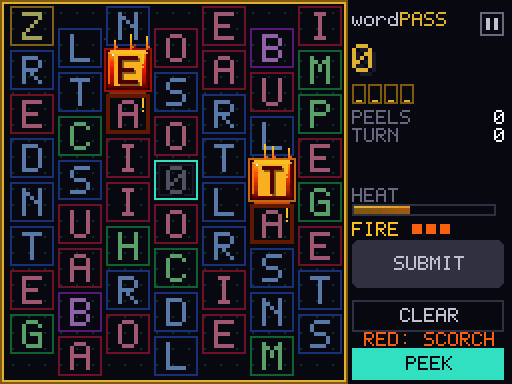
*The red risk marks. The gems directly under the two flames are marked; peeling either one scorches the back layer. The flame gems blink a bang too.*

---

## 7. The pass and the themes

### 7.1 How the pass is chosen

Every shelf draws its pass from a themed pool in `data/pools.bin`, and the plaque on the top screen names the theme (`PASS - BINDERY`).

* **Theme.** Classic shelf *n* uses theme `(n − 1) mod 40`: shelf 1 BINDERY, shelf 2 INK ... shelf 40 LEXICON, then round again from BINDERY.
* **Length by shelf.** 4 letters on shelves 1 to 2, 5 on shelves 3 to 5, 6 on shelves 6 to 8, 7 on shelves 9 to 12, 8 from shelf 13. A **BURIED** twist adds one. If the theme has no word of that length the nearest length stands in (the longer one on a tie).
* **The familiarity window.** Each pool runs from familiar to obscure words, and a shelf only draws from the first **48 + 24 × shelf** words of the right length, so early shelves stay familiar and deep ones open the whole pool.
* **No repeats.** The last **eight** passes of the run are not repeated while the pool has a choice.
* **Daily Pass.** Theme and length come from the date (section 10) and the word from the first 200 words of that length, so it stays familiar.

The pass words are checked against the dictionary, and the word library never goes rougher than a mild curse: the strongest words in it are *holy*, *damn*, *crappola* and *moobs*. The pass is placed on the back layer as a random walk that starts in rows at or below the shelf's **first pass row** and never climbs above it: the letters form one connected clump, deeper on harder shelves (section 9). Letters can be found in any order.

### 7.2 The forty themes

<!-- check:themes -->
| Shelf | Theme | Words | Examples (familiar first) |
| --- | --- | --- | --- |
| 1 | **BINDERY** | 156 | book, spine, jacket, binding, endpaper, signature |
| 2 | **INK** | 120 | font, quill, scribe, cursive, charcoal, parchment |
| 3 | **VERSE** | 113 | poem, rhyme, sonnet, epigram, limerick, interlude |
| 4 | **TALES** | 152 | myth, fable, legend, romance, thriller, biography |
| 5 | **ATLAS** | 478 | pole, atlas, tropic, compass, meridian, gazetteer |
| 6 | **ARCHIVE** | 82 | roll, vault, ledger, lexicon, register, chronicle |
| 7 | **LAMP** | 84 | lamp, ember, candle, lantern, twilight, fireplace |
| 8 | **STUDY** | 128 | sofa, study, alcove, lectern, armchair, chemistry |
| 9 | **BEASTS** | 362 | down, human, entire, mankind, elephant, butterfly |
| 10 | **MUSIC** | 148 | tune, music, melody, harmony, baritone, xylophone |
| 11 | **HERBAL** | 323 | glad, shoot, simple, heather, veronica, pineapple |
| 12 | **VOYAGE** | 150 | ship, yacht, vessel, galleon, schooner, starboard |
| 13 | **COOKERY** | 419 | wine, drink, dinner, chicken, sandwich, breakfast |
| 14 | **MYTH** | 121 | ares, hades, apollo, cyclops, basilisk, leviathan |
| 15 | **ANATOMY** | 298 | back, blood, behind, breathe, shoulder, permanent |
| 16 | **PLAY** | 189 | game, score, sprint, stadium, marathon, badminton |
| 17 | **ALCHEMY** | 406 | till, water, silver, plastic, material, crackling |
| 18 | **WEATHER** | 134 | rain, sleet, clouds, thunder, blizzard, lightning |
| 19 | **GUILD** | 337 | more, chief, doctor, general, director, president |
| 20 | **SMITHY** | 372 | mike, watch, weapon, machine, computer, automatic |
| 21 | **ATTIRE** | 148 | suit, dress, turtle, clothes, necklace, underwear |
| 22 | **HOUSE** | 215 | safe, truck, bottle, kitchen, bathroom, ambulance |
| 23 | **MOODS** | 233 | love, enjoy, please, passion, surprise, surrender |
| 24 | **CURSES** | 64 | holy, moobs, damned, hogwash, crappola, poppycock |
| 25 | **WORDS** | 1050 | okay, thank, thanks, talking, speaking, screaming |
| 26 | **DEEDS** | 1271 | help, going, coming, getting, watching, listening |
| 27 | **MOTION** | 126 | come, bring, follow, descend, withdraw, replicate |
| 28 | **TRAITS** | 3967 | just, right, better, through, together, beautiful |
| 29 | **CLANS** | 310 | dead, party, people, company, military, following |
| 30 | **MINDS** | 562 | know, whole, listen, believe, remember, attention |
| 31 | **FOLK** | 1274 | have, great, father, brother, daughter, detective |
| 32 | **TIMES** | 179 | then, years, second, morning, tomorrow, yesterday |
| 33 | **MAKING** | 227 | shut, dirty, create, imagine, activate, improvise |
| 34 | **WARES** | 976 | well, still, office, working, hospital, apartment |
| 35 | **SHAPES** | 342 | much, first, little, nothing, thousand, relations |
| 36 | **CHANGE** | 239 | slow, sober, happen, correct, complete, disappear |
| 37 | **TRADE** | 261 | take, money, things, letting, property, insurance |
| 38 | **STATES** | 646 | want, thing, chance, problem, security, situation |
| 39 | **EVENTS** | 454 | time, start, change, wedding, accident, happening |
| 40 | **LEXICON** | 787 | looks, really, friends, happened, sometimes |

The library holds **17,903 pass words** in 40 themes. The table lists each theme's examples at each length from 4 to 9 letters, most familiar first (LEXICON has no four-letter words). The eight bookish themes of shelves 1 to 8 are the original ones. The number of words at each length varies; here is the split for the first eight themes:

<!-- check:pool-lengths -->
| Theme | 4 | 5 | 6 | 7 | 8 | 9 |
| --- | --- | --- | --- | --- | --- | --- |
| BINDERY | 19 | 28 | 33 | 25 | 34 | 17 |
| INK | 23 | 23 | 30 | 18 | 16 | 10 |
| VERSE | 11 | 20 | 24 | 26 | 19 | 13 |
| TALES | 17 | 31 | 38 | 34 | 20 | 12 |
| ATLAS | 76 | 94 | 92 | 79 | 86 | 51 |
| ARCHIVE | 10 | 13 | 20 | 23 | 9 | 7 |
| LAMP | 17 | 21 | 14 | 13 | 11 | 8 |
| STUDY | 11 | 19 | 25 | 33 | 25 | 15 |

### 7.3 What a diamond is

A **diamond** is a pass letter you have found: the gem you peeled turns into a diamond showing the pass letter. It is a real gem for chaining (its letter counts, and a word through it is a **PASS LINK** worth half again), it **never burns**, it does not fall and it **stops fire**. It stays on the board after a word uses it. When the last diamond appears the shelf is cleared.

---

## 8. Fire, exactly

Fire is the clock of wordPass. Everything you do adds **heat**; when the heat meter fills, a gem ignites; flames creep down the board; a flame that reaches the floor ends the shelf.

### 8.1 Heat

Every turn adds heat. A word adds heat by its length (a Qu gem counts for two letters); a peel adds a fixed amount.

<!-- check:heat -->
| Word length | Heat |
| --- | --- |
| 3 | 3 |
| 4 | 2 |
| 5 to 6 | 1 |
| 7 and up | 0 |

* A **peel** adds **1** heat (**2** in Lockdown).
* A **Lockdown pulse** adds **2** more on every turn that is a multiple of the pulse interval (section 9).
* **Overtime** adds heat every turn once the shelf has taken too many turns (section 8.6).

The panel previews the cost of the chain you hold on the **HEAT** line (`+2 HEAT`, or `NO HEAT` for a free word), pulse and overtime included.

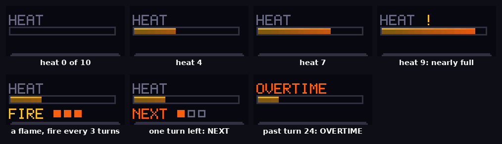
*The HEAT line and bar and the fire pips. At more than half full a `!` blinks beside HEAT. Under it, while a flame burns, a row of pips counts the turns to the next fire step; the last pip blinks NEXT. Past the turn limit the label reads OVERTIME.*

### 8.2 The meter

The meter's size depends on the shelf (section 9): **10** on shelves 1 and 2, **7** on shelves 3 to 5, **5** from shelf 6, then **4** from shelf 12. When the heat reaches the meter's size the shelf **ignites a gem** and the heat goes back to **0**: any extra is lost, and **heat never cools down by itself**. If no gem is left to light, the meter stays one short instead.

### 8.3 The FIRE setting

The FIRE option moves two numbers for Classic shelves: how often the fire moves and how big the meter is. The table shows `meter / turns per step`:

<!-- check:fire-settings -->
| Shelf | RELAXED | NORMAL | FAST |
| --- | --- | --- | --- |
| 1 | 13 / 3 | 10 / 2 | 8 / 1 |
| 3 | 10 / 3 | 7 / 2 | 5 / 1 |
| 5 | 10 / 2 | 7 / 1 | 5 / 1 |
| 6 | 8 / 2 | 5 / 1 | 4 / 1 |
| 9 | 8 / 2 | 5 / 1 | 4 / 1 |
| 12 | 7 / 2 | 4 / 1 | 4 / 1 |
| 15 | 7 / 2 | 4 / 1 | 4 / 1 |

RELAXED adds one turn to the fire clock and **3** to the meter; FAST makes the fire move **every turn** and takes **2** off the meter (never below 4). The **Daily Pass** ignores the FIRE setting.

### 8.4 How a flame is born

When the heat reaches the meter, the game picks a **random column**, then lights the **topmost plain gem** of that column (holes, diamonds and empty cells above it are skipped). A column with no plain gem is skipped and the next one is tried. From **Lockdown tier 2** (shelf 12) every ignition lights **two different columns**. The new flame appears **after** that turn's fire step, so it always sits for at least one full step before it moves.

### 8.5 How a flame moves

The fire moves on a **clock**: every `fire every` turns (the *burn clock*: 2 on shelves 1 to 3, 1 after) all flames take a **step**. In a step each flame, bottom first:

1. looks down its column, skipping **holes** (they are chimneys: fire falls straight through them);
2. if the first thing it meets is a **plain gem**, it burns it and moves onto it (the flame's old cell is refilled with a new gem);
3. if the first thing it meets is a **diamond** or another **flame**, it stays where it is (**diamonds are firebreaks**);
4. if it has nothing left to burn below it (only holes to the floor), the **library is lost**;
5. a flame already on the **bottom row** when a step begins also loses the library.

So a flame that starts on the top row needs seven steps to reach row 7 and an eighth to end the shelf, but a flame above a stack of holes jumps all of them in one step. **Holes are express lanes for fire**, so peel with care. A flame also **hangs where it is** when the gems under it are cleared: refilled gems drop in behind it, but fire only moves on the clock.

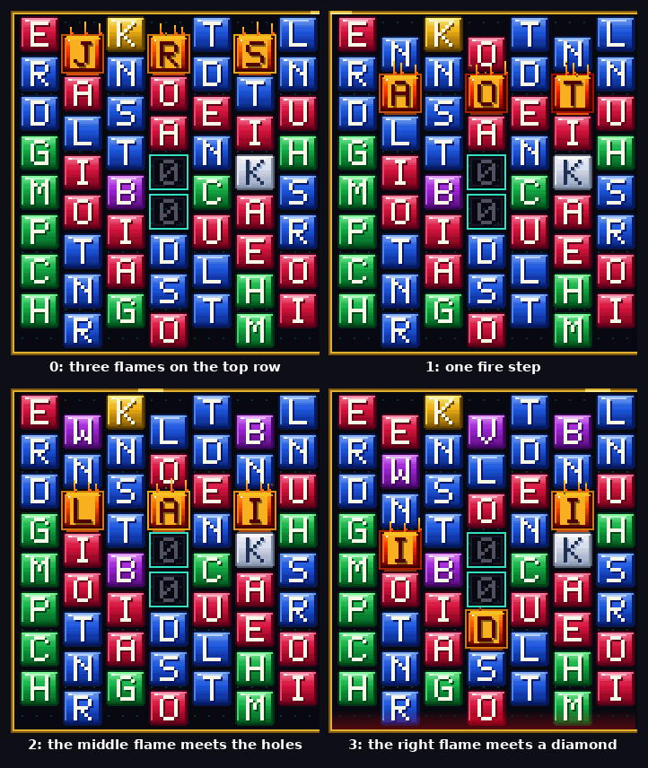
*Fire in four frames. The middle flame falls through the holes below it in one step; the right-hand flame is stopped by the diamond. The left flame simply creeps one gem per step.*

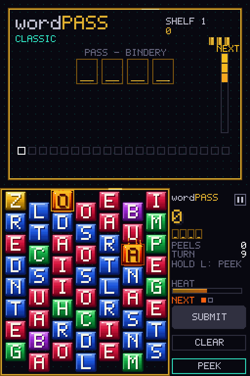
*A burning shelf. On the top screen the **fire meter** (right) fills from the top down to the **lowest** flame: the further it fills, the closer the shelf is to LIBRARY LOST. On the panel, the pips count the turns to the next step.*

### 8.6 Putting a flame out, and overtime

Spell a word **through** the burning gem and it is cleared: the flame is gone, and the word earns **+30 per letter**. Several flames can be put out with one long word.

**Overtime.** A shelf you camp on will burn. Past **turn 24** (**turn 16** in Lockdown) every turn adds heat of its own: 1 for the first 23 turns of overtime, then 2 for the next 24, then 3, 4... The table reads *turns past the limit*:

<!-- check:overtime -->
| Turns past the limit | Extra heat every turn |
| --- | --- |
| 1 to 23 | +1 |
| 24 to 47 | +2 |
| 48 to 71 | +3 |
| 72 to 95 | +4 |

The limit is 24 turns in Classic (so turn 25 is the first overtime turn; turn 48 is the first to add +2) and 16 in Lockdown. The turn counter on the panel turns red and the heat label says **OVERTIME**.

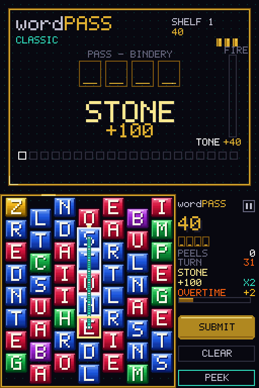
*Past the turn limit: OVERTIME replaces HEAT and the turn counter turns red.*

### 8.7 The three ways to lose a shelf

<!-- check:fail-cards -->
| Card | Cause |
| --- | --- |
| `LIBRARY LOST` | a flame was on the bottom row when the fire stepped, or a flame had nothing left to burn below it |
| `PASS DESTROYED` | you scorched a cell that hid a pass letter (section 6.7) |
| `OUT OF WORDS` | no word of 3 to 5 letters can be spelled from the gems left |

OUT OF WORDS is checked after every turn by searching the board for any accepted word of 3 to 5 letters through gems, diamonds and flames: so the LIBRARY and SPELLING options matter (COMMON is stricter).

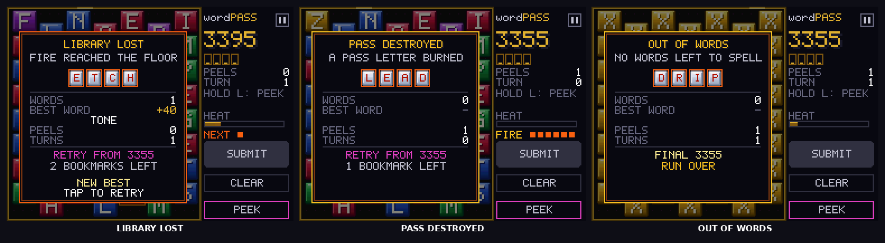
*The fail cards. Each shows why, the pass (the letters you had found stay lit, the others are shown red), your words, best word, peels and turns, and what the retry costs: the score the shelf started with, and the bookmarks left. The last card is a run over: no bookmark remained.*

---

## 9. Climbing: bookmarks, twists and Lockdown

### 9.1 Bookmarks

A Classic run starts with **three bookmarks**, shown as small gold books on the top screen.

* A **failed shelf** costs one bookmark. You retry the same shelf (a fresh board, and a different pass if the pool has a choice) with the score the shelf started with.
* **RESTART SHELF** in the pause menu also costs one, and it is refused on your last bookmark (**LAST BOOKMARK**).
* Clearing a **Lockdown** shelf earns one back, up to three.
* With none left the run is over: the fail card says **RUN OVER**, and a tap takes you to the title. The run counts as a game in the Ledger.

The Daily Pass has no bookmarks: it is one attempt.

### 9.2 Twists

Classic shelves **4, 7, 10, 13 ...** (every third shelf from the fourth) carry one **twist**, announced as you arrive (`SHELF 4: INK SPILL`) and named beside the mode label for the first two seconds. A twist that matches the previous twist is rerolled once, so repeats are rare. The Daily has no twists.

<!-- check:twists -->
| Shelf | INK SPILL | DAMP | BURIED |
| --- | --- | --- | --- |
| 4 | 7 / 1 / 5 | 5 / 2 / 5 | 7 / 1 / 6 |
| 7 | 5 / 1 / 6 | 3 / 2 / 6 | 5 / 1 / 7 |
| 10 | 5 / 1 / 7 | 3 / 2 / 7 | 5 / 1 / 8 |
| 13 | 4 / 1 / 8 | 3 / 2 / 8 | 4 / 1 / 9 |
| 16 | 4 / 1 / 8 | 3 / 2 / 8 | 4 / 1 / 9 |

Each cell is `meter / turns per step / pass length` on FIRE NORMAL.

* **INK SPILL:** three cells are already holes when the shelf opens (in rows 2 to 6, never over a pass letter). The board is rerolled up to ten times if the spill leaves no word. The spill gives you free numbers.
* **DAMP:** the fire creeps **one turn slower**, but the meter is **two shorter** (never below 3). Spend heat carefully.
* **BURIED:** the pass is **one letter longer** and lies entirely in the **bottom three rows** (rows 5 to 7).

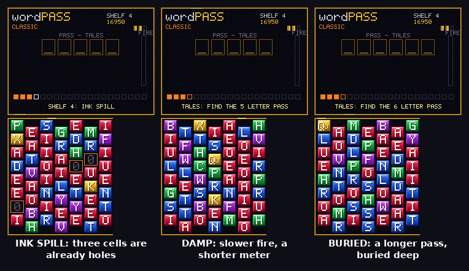
*The three twists on shelf 4. INK SPILL (left): holes on the board. DAMP (middle): nothing to see on the board, but the meter is shorter. BURIED (right): six slots on a shelf that normally has five.*

### 9.3 Lockdown

From **shelf 6**, the shelf is in **Lockdown**: the music turns to one of the dark songs, the mode label turns red, and the rules tighten.

* The fire moves **every turn**.
* A peel adds **2 heat**, not 1.
* A **heat pulse** adds 2 heat on every turn that is a multiple of the pulse interval.
* The pass is buried deeper (section 9.4), and **overtime starts at turn 16**.
* Clearing a Lockdown shelf earns a **bookmark** back.

Lockdown climbs in **tiers**, every three shelves: the panel reads LOCKDOWN, LOCKDOWN II, III, IV.

| Tier | Shelves | Pulse every | Meter | Notes |
| --- | --- | --- | --- | --- |
| I | 6 to 8 | 6 turns | 5 | |
| II | 9 to 11 | 5 turns | 5 | |
| III | 12 to 14 | 4 turns | 4 | every ignition lights **two** columns |
| IV | 15 and up | 3 turns | 4 | every ignition lights two columns |

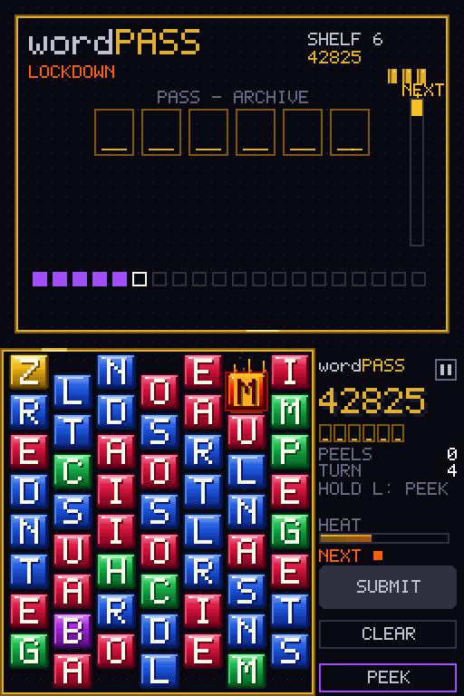
*Shelf 6, LOCKDOWN. The mode label is red, the six-letter pass is buried in the lower rows, a flame stands on the top row and the pips say NEXT: the fire moves every turn.*

### 9.4 The difficulty ladder

<!-- check:ladder -->
| Shelf | Meter | Fire every | Lockdown | Pulse | First pass row | Pass length |
| --- | --- | --- | --- | --- | --- | --- |
| 1 | 10 | 2 | no | - | 1 | 4 |
| 2 | 10 | 2 | no | - | 1 | 4 |
| 3 | 7 | 2 | no | - | 3 | 5 |
| 4 | 7 | 1 | no | - | 3 | 5 |
| 5 | 7 | 1 | no | - | 3 | 5 |
| 6 | 5 | 1 | yes | 6 | 4 | 6 |
| 7 | 5 | 1 | yes | 6 | 4 | 6 |
| 8 | 5 | 1 | yes | 6 | 4 | 6 |
| 9 | 5 | 1 | yes | 5 | 4 | 7 |
| 10 | 5 | 1 | yes | 5 | 4 | 7 |
| 11 | 5 | 1 | yes | 5 | 4 | 7 |
| 12 | 4 | 1 | yes | 4 | 5 | 7 |
| 13 | 4 | 1 | yes | 4 | 5 | 8 |
| 14 | 4 | 1 | yes | 4 | 5 | 8 |
| 15 | 4 | 1 | yes | 3 | 5 | 8 |
| 16 | 4 | 1 | yes | 3 | 5 | 8 |
| 17 and up | 4 | 1 | yes | 3 | 5 | 8 |

The ladder is for FIRE NORMAL with no twist. *First pass row* is the shallowest row that can hold a pass letter (the top row is row 0): on shelf 1 and 2 the pass can be anywhere but the top row, on shelves 3 to 5 only rows 3 to 7, in Lockdown rows 4 to 7 and from shelf 12 only the bottom three rows 5 to 7. **The top row never holds a pass letter on any shelf.**

Pass depth is the other clock: the lower the pass, the more of the board you must peel through, and the longer a flame has to find your peels.

---

## 10. Daily Pass and the Ledger

### 10.1 The seed

The **Daily Pass** is one fixed shelf for everyone on a date. The game reads the DS clock, turns the date into a number `YYYYMMDD` and uses it as the **seed** for everything random on the shelf: the board, its refills, the fire. Two players on the same date get the same board, the same pass and the same fire if they play the same words. The daily **modifier** is bits 28 and 29 of `seed × 2654435761` (as a 32-bit number), and the **theme** and **pass length** come from that number shifted right by 8 (the theme is it modulo 40; the pass is 6 letters when bit 3 of the shifted number is set and 5 otherwise, or 7 under LONG; the word is its index modulo the pool's first 200).

A Daily is **one shelf, shelf 1**: a pass clears it and a tap on the card goes back to the title.

### 10.2 One scored attempt, then practice

* **The first Daily you start on a date is the scored one.** Starting it **spends the attempt**, even if you quit from the pause menu (the score so far stands).
* Every later start that day is **PRACTICE**: the same board, announced as `PRACTICE RUN: NOT SCORED`, and nothing from it is recorded: not the score, not the streak, not the lifetime statistics.
* The title button shows the state: the date and the day's modifier before the attempt, `PRACTICE` with your score after it, `SET CLOCK` when the clock is unreadable.
* The pause menu has no RESTART row in the Daily.

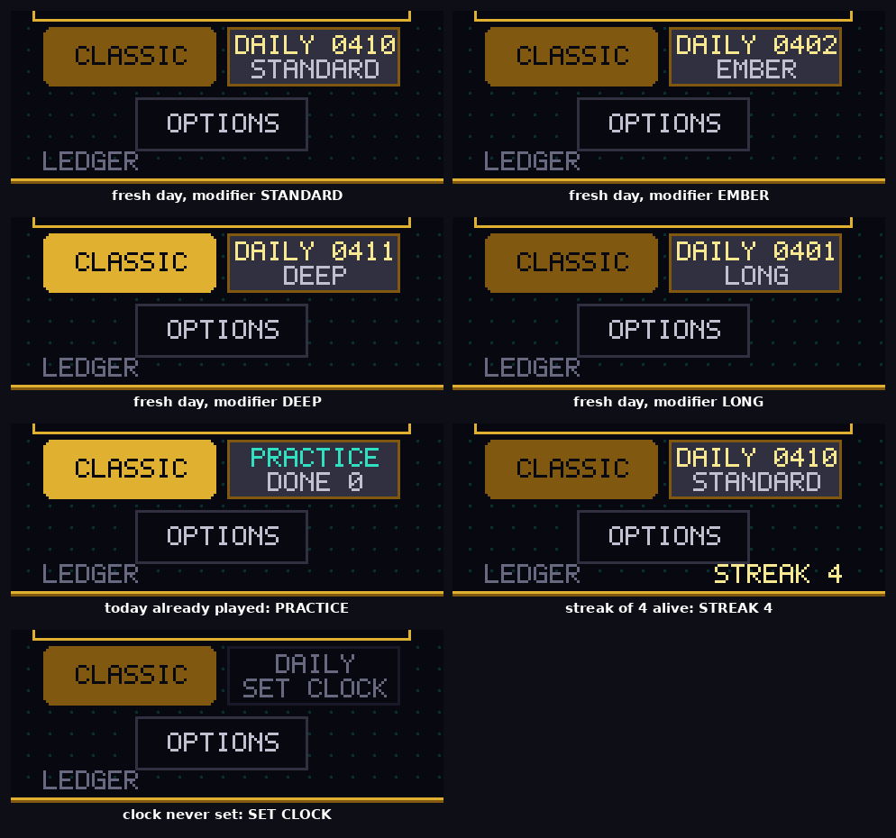
*The title's Daily button. Top four: a fresh day under STANDARD, EMBER, DEEP and LONG. Then PRACTICE (the score of your last scored Daily follows DONE), a live streak (the STREAK 4 shows at the right of the BEST line), and an unset clock.*

### 10.3 The four modifiers

<!-- check:daily-mods -->
| Modifier | Meter | Fire every | First pass row | Pass length |
| --- | --- | --- | --- | --- |
| **STANDARD** | 7 | 2 | 3 | 5 or 6 |
| **EMBER** | 8 | 1 | 3 | 5 or 6 |
| **DEEP** | 7 | 2 | 5 | 5 or 6 |
| **LONG** | 7 | 2 | 3 | 7 (or the nearest the theme has) |

STANDARD is the plain shelf. **EMBER**: the fire moves every turn (the meter is 8). **DEEP**: the pass is buried in the bottom three rows. **LONG**: a seven-letter pass.

### 10.4 The streak

* A scored Daily on the **day after your last one** adds to your streak. A missed day starts it over at 1. Two scored Dailies on the same date cannot happen (the second is practice).
* The title shows `STREAK n` from **2 days**, while the streak is *alive*: your last scored Daily was today or yesterday. Once a day is missed it reads nothing, and the next scored Daily starts at 1.

### 10.5 The clock requirement

Daily needs a DS clock that reads **2025-01-01 or later** (up to 2099-12-31). If the clock was never set the button reads **SET CLOCK** and the Daily will not start (`SET THE DS CLOCK FOR DAILY`). The title re-reads the clock once a second, so midnight passing under an idle title moves the Daily to the new date. Daily dates are taken as the clock reads them (no time-zone conversion).

### 10.6 The Ledger

Press **X** on the title (or tap the BEST line) for **THE LEDGER**: your lifetime record, kept on the card.

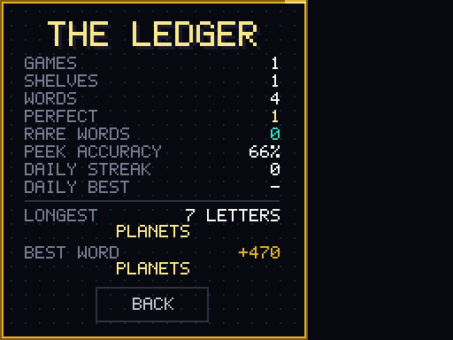
*The Ledger after a short session: one run, one shelf cleared, four words, one perfect pass, 66% peek accuracy (four of six peels found a pass letter), and the longest and best word.*

| Line | How it is counted |
| --- | --- |
| GAMES | a Classic run when it ends on its last bookmark, a Daily when its scored attempt ends |
| SHELVES | shelves cleared (a Classic shelf each time; a Daily that was passed) |
| WORDS | every word accepted (repeats included; practice runs excluded) |
| PERFECT | shelves cleared with a PERFECT PASS |
| RARE WORDS | accepted words of the rare tier |
| PEEK ACCURACY | peels that found a pass letter, as a percentage of all peels (scorched peels count as misses) |
| DAILY STREAK | the live streak (0 once a day is missed) |
| DAILY BEST | your best scored Daily and its date |
| LONGEST | your longest word, with its length |
| BEST WORD | your highest-scoring word and its points |

The title's **BEST** line is your best Classic score. A Classic score is recorded when a shelf ends (cleared or failed); a new record flashes **NEW BEST** on the card. The best shelf reached is saved too.

---

## 11. Options and accessibility

Open **OPTIONS** from the title (the button, or **Y**). Tap the left half of a row to step its value back and the right half to step it forward, or use the d-pad (up and down pick a row, left and right change it, **A** steps forward). The chevrons on the row flash when they act. The top screen shows a **sample board** in the current theme, accent and frame, with a line of help about the lit row.

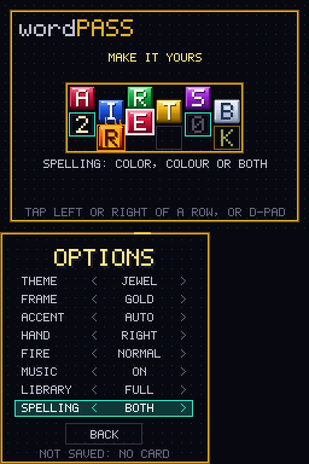
*The options screen with LANGUAGE lit. The list always sits in the same place, whichever hand you play with.*

<!-- check:options -->
| Option | Values | Effect |
| --- | --- | --- |
| THEME | JEWEL, INK, CANDY, EMBER, CLEAR | the gem palettes: JEWEL jewel tones, INK slate gems with a tinted edge, CANDY pastels, EMBER warm tones, CLEAR the colour-blind-safe palette |
| FRAME | GOLD, SILVER, ACCENT | the colour of the board frame |
| ACCENT | AUTO, TEAL, MAGENTA, LIME, ORANGE, SKY, VIOLET, PINK, MINT | the highlight colour; AUTO changes it every shelf |
| HAND | RIGHT, LEFT | which side the board and panel go (section 2.3) |
| FIRE | RELAXED, NORMAL, FAST | how fast the Classic shelf burns (section 8.3) |
| MUSIC | ON, OFF | the soundtrack (section 13) |
| LIBRARY | FULL, COMMON | FULL accepts every dictionary word, COMMON refuses rare ones with TOO OBSCURE |
| SPELLING | BOTH, AMERICAN, BRITISH | which spellings are accepted, English only (section 4.3) |
| LANGUAGE | ENGLISH, ESPANOL, FRANCAIS, DEUTSCH, ITALIANO, PORTUGUES, NEDERLANDS, SVENSKA, POLSKI, DANSK, SUOMI | the language of the tiles, words and pass words (section 14) |

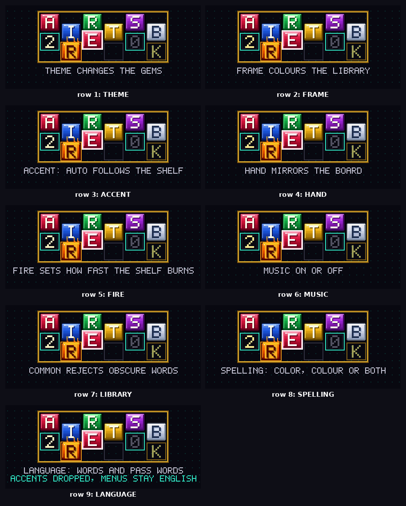
*Each row's help line, from the top screen. The sample board shows a gem of every palette, a diamond, a hole with a number, a burning gem, a chained gem, an empty cell and a peeked ghost, all drawn by the very code the board uses.*

### 11.1 Themes, frames and accents

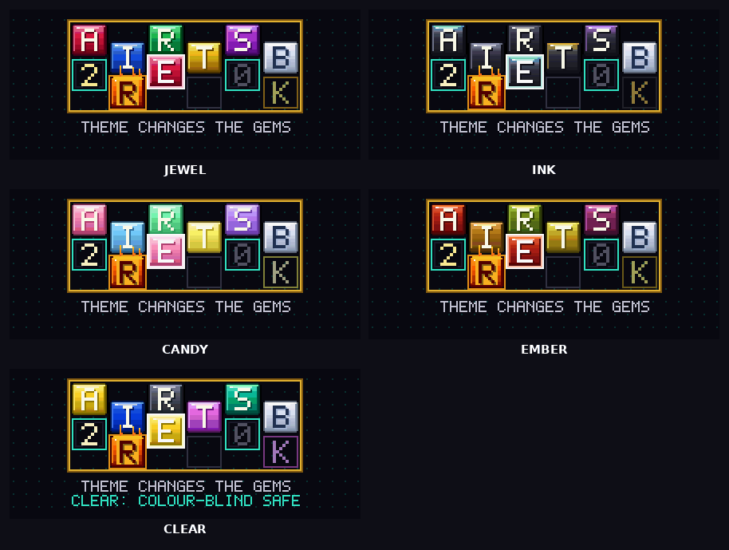
*The five themes on the options sample board. CLEAR adds its own second help line.*

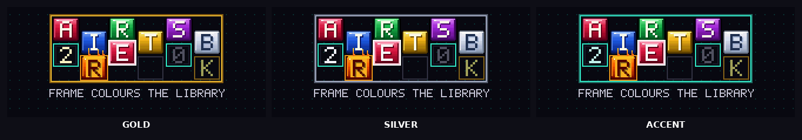
*The three frames.*

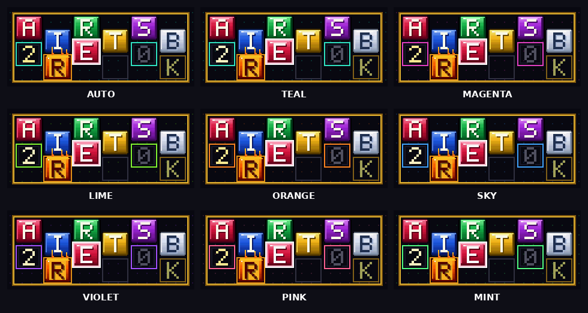
*The nine accents: AUTO and eight fixed colours.*

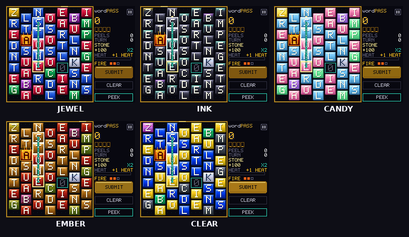
*The same position in play, in JEWEL, INK, CANDY, EMBER and CLEAR.*

### 11.2 Playing without colour

* **CLEAR** is the colour-blind-safe palette: yellow, blue, magenta, teal and grey, which differ in **lightness** as well as hue (section 3.2 shows it beside JEWEL).
* **Fire is told apart by light, not hue**: a burning gem has a light plate under a dark letter, a bright bar across its top and flame tongues, in **every** theme. The fire countdown is spelled out too: the label says `FIRE`, and `NEXT` on the last turn before a step.
* Hole numbers are digits, so colour is only a second cue.
* **Left-handed play** mirrors the touch layout (section 2.3) and the hint names the shoulder under your idle hand.
* **Playing with the d-pad alone** works for the whole game (section 2.4).

### 11.3 The saved file

Settings, records, the Daily state and the Ledger are saved to **`wordPass.cfg`** on the card when a FAT filesystem is available (flashcarts with DLDI, DSi SD). The file is **136 bytes**, written to `wordPass.cfg.tmp` and renamed over the old one, so a card pulled mid-write leaves the previous file intact. It carries a CRC-16 checksum: a damaged file falls back to the defaults. It still reads the older 28-byte format. It is saved when you leave OPTIONS, when you tap past a results or fail card, when you quit to the title, when you start a scored Daily, when a record changes and when you finish the first guided shelf.

**Without a card** (an emulator without a FAT image, a DS without a flashcart) everything lasts for the session and the options screen says `NOT SAVED: NO CARD`. If a write fails it says `SAVE FAILED`. With a card it says `SAVED TO CARD`.

---

## 12. Strategy guide

### 12.1 What actually scores

On early shelves a good word is worth a few hundred points. Clearing the shelf is worth thousands:

| On shelf 3 (a five-letter pass) | Points |
| --- | --- |
| a strong seven-letter word | about 500 |
| five pass letters | 1500 |
| shelf bonus | 3000 |
| speed bonus for a 10-turn shelf | 2250 |
| perfect pass bonus | 1200 |

So the game is a **race**: every turn you spend costs 25 × shelf points of speed bonus, and the shelf bonus and pass letters dwarf any single word. Words are the tool that keeps the fire at bay and keeps your options open, not the goal. The words that *are* worth spelling are long ones (zero heat), flame-killers, and ones that keep you under the meter.

### 12.2 Openings and the first five turns

1. **Look before you touch.** On shelf 1 the pass is a four-letter word in rows 1 to 7: **row 0 can never hold a pass letter.** On shelves 3 to 5, rows 0 to 2 are free, in Lockdown rows 0 to 3, from shelf 12 rows 0 to 4. Do not peel in the free zone unless you need its numbers.
2. **Peek in the middle of the band.** The first peel is a guess; make it where a number tells you the most, in the middle of the rows that may hold the pass, so that the number counts the largest possible set of cells.
3. **A zero is gold.** If the first peel is a 0, peel its neighbours' neighbours: you have cleared up to six cells for one turn.
4. **A number greater than 0 is a direction.** Peel a neighbour that is *not* in the clump (open edge) and compare the two numbers.
5. **Spell a word when the fire needs it, not by reflex.** On shelves 1 to 2 the meter is 10: you can take nine peels without a word and no flame appears at all. A long word on turn 1 scores, but costs a turn.

### 12.3 Heat budgeting

Heat only goes up; it resets only when a gem ignites. A peel costs 1 and a long word costs 0, so the cheapest turns on the board are **words of seven or more letters** and, next, five- and six-letter words (1 heat). A three-letter word costs 3: *the same as three peels*. Keep a running count: if the meter is at 6 of 7 the next ignition is one turn away; make that turn a long word, which adds nothing, or a peel you must make anyway.

| Move | Heat | Turn |
| --- | --- | --- |
| 3-letter word | 3 | 1 |
| 4-letter word | 2 | 1 |
| 5 or 6 letter word | 1 | 1 |
| 7+ letter word | 0 | 1 |
| a peel | 1 (2 in Lockdown) | 1 |

### 12.4 When to peel and when to chain

* **Peel** when you know where to peel: a number has pinned a cell, or two numbers have. Every peel that finds a letter moves you toward the bonus.
* **Chain** to kill a flame, to draw new gems when the board has no good long words or no safe peels, or to build a PASS LINK (below).
* **Never peel under a flame.** First put the flame out with a word through it. Under a flame you risk the whole pass.

### 12.5 Reading the board for chain-through-diamond links

A diamond is a free multiplier: any word through it earns half again, and it never leaves. Once you have two diamonds, a chain through **both** earns x2. So after you find a letter, look for words that include it: its letter is a letter like any other. Because diamonds are firebreaks and floors, a column with a diamond is also a column the fire cannot cross: put your peels *behind* a diamond (below it) rather than above.

### 12.6 Endgames

* With one letter left and one number, count: the number minus the diamonds around it is how many unpeeled neighbours are letters. If the answer is the neighbour count, they are all letters (puzzle 3).
* With the last cells ambiguous, **peel the cell that cannot scorch** first, then use the new number.
* **Do not go into overtime**: on turn 25 (17 in Lockdown) every turn adds heat. If the shelf is slow, take a long, free word only if it helps.

### 12.7 Lockdown

The meter is 5 or 4 and a peel is 2 heat: two peels can light a gem. Long words through flames are the best move in the game: they put the flame out and add no heat. Keep gems that spell long words together. On tier III and IV each ignition lights two columns, so two flames at once is normal: kill the lower one first.

### 12.8 The Daily modifiers

* **STANDARD:** meter 7, the fire moves every second turn, a five- or six-letter pass in rows 3 to 7.
* **EMBER:** the fire moves every turn: a flame on row 0 reaches the floor in eight turns. Clear flames early.
* **DEEP:** the pass is in rows 5 to 7. Peel low from the start; the top five rows are free.
* **LONG:** a seven-letter pass means seven peels at least: keep the heat low and do not waste a peel.

### 12.9 Ten common mistakes

1. Peeling under a flame.
2. Reflexively spelling three-letter words (3 heat each).
3. Peeling in the free rows without needing to.
4. Forgetting that a hole in a column is an express lane for fire.
5. Forgetting that found letters (diamonds) still count in the numbers around them.
6. Camping past turn 24: overtime heat arrives every turn.
7. Ignoring a flame near the floor: the lowest flame is on the top-screen fire meter.
8. Spelling the same word twice: the second is halved.
9. Restarting a shelf casually: it costs a bookmark.
10. Skipping the numbers: a peel that reads a 0 is not wasted, but a peel without reading the board is.

### 12.10 The one-page cheat sheet

| | |
| --- | --- |
| **Score** | (letter values) x length multiplier x 10; +200 at 7 letters; +30 per letter through a flame; +50% per diamond (two at most); repeats halved |
| **Multiplier** | 3-4 letters x1, 5-6 x2, 7-8 x3, 9+ x4 |
| **Heat** | 3-letter word 3, 4 letters 2, 5-6 letters 1, 7+ 0; a peel 1 (2 in Lockdown) |
| **Meter** | 10 (shelves 1-2), 7 (3-5), 5 (6-11), 4 (12+) |
| **Overtime** | past turn 24 (16 in Lockdown): +1 heat, growing every 24 turns |
| **Pass pays** | 100 per letter x shelf; 1000 x shelf; 25 x shelf per turn under 40; PERFECT 400 x shelf; CLEAN 150 x shelf |
| **Hole number** | how many of the 6 neighbours hide a pass letter (found letters count) |
| **Scorch** | peeling a flame or the gem directly under one; a letter there is lost |
| **Fire** | on the clock; holes are express lanes; diamonds block it; spell through a flame to put it out |
| **Pass rows** | the top row is never a pass cell; the pass is one connected clump |
| **Lose** | LIBRARY LOST, PASS DESTROYED, OUT OF WORDS |

---

## 13. Music and sound

> **Regenerated section.** This section describes the soundtrack as the code does *today* (`source/music.c`, with the sound effects and mixes on top of it). When the music changes again, `tools/emu/screens.py` and `python3 tools/check_guide.py` find what moved (the constants and keys below are parsed from the source by the checker), and this section is updated to match.

There are no samples: the soundtrack is **sequenced live on the DS's eight sound channels** (six square-wave voices and two noise voices), each with its own instrument, so every layer can be mixed by game state. It is **ten songs** (the list is at the end of this section), each a short tune with its own key, tempo, bass riff, drum groove and instruments, distilled from the songs of the author's other game; `docs/MUSIC.md` is the listening guide and the credits.

<!-- check:music -->
| Constant | Value |
| --- | --- |
| MIN_STEP_FRAMES | 5 |
| PATTERN | 64 |

A step is a sixteenth note of **5 to 12 frames** depending on the song (180 down to 75 beats per minute) and a pass through the pattern is **64 steps**, four bars. Every tune has the form **A A B A**: the four-bar hook plays twice, then a four-bar answer phrase over a different chord walk, then the hook again: sixteen bars in all.

| Layer | What it does | How it reacts |
| --- | --- | --- |
| **Hook** (square; each song has its own: a bell, a rhodes, a whistle, an oud, an acid lead ...) | the tune, which never stops | the song's own key and mode (the dark songs are minor, harmonic minor or hijaz, with the raised seventh on the V chord where the song asks for it); it sits in a singable register in every song |
| **Pulse** (square, plucked) | a chord arpeggio, always on, ping-ponging between the speakers | thins to a slow heartbeat an octave down while you peek, and drops an octave while paused |
| **Bass** (square) | the song's one-bar riff (octave bounce, off-beat house pulse, rolling 16ths, a hijaz drone ...) | plays while you keep spelling words and fades after about three quiet bars |
| **Pad** (square, swells in) | slow chord tones an octave under the lead | swells one chord tone per pass letter found |
| **Drums** (noise) | hat, kick and snare in the song's own groove (four on the floor, a half-time snare, a two-step, a breakbeat ...) | level 1 (a word of 1 to 4 letters) is a closed hat; level 2 (5 to 6 letters) adds kick and snare, with a ghost kick before bars two and four; level 3 (7+ letters) runs the full groove with accented hats, an open hat at the top of every loop and a snare fill into the last beat of bar four; the level decays one notch after eight bars |
| **Chimes** (square) | one-shot notes that climb the chord with the length of the word | one note for 3 letters, two for 4, three for 5 or 6, four for 7 (the last held with vibrato), a six-note run for 8 and up (which also lifts the pad for a moment); a word worth 500 or more rings louder; a word through a flame hisses like steam |
| **Alarm** (square) | a pulsed two-tone blip | comes faster and louder the lower the fire has burned (every eighth step on the top rows, every step near the bottom) |

**Tempo.** While a flame is on row 3 or lower the whole tune speeds up by one frame a step, on row 5 or lower by two (never faster than 5 frames a step), and it relaxes one bar after the shelf is fire-free.

**Which song.** The **title, options, ledger, guide, language chooser and first-boot chooser** all play one dedicated **menu song**, a slow, warm music box. **Classic** shelves rotate through five songs by shelf (shelf 1 the first, shelf 6 the first again); **Lockdown** plays a dark, hard song by tier (tier 0 the slowest, tiers 2 and 3 the hardest); a Classic shelf on **FIRE: FAST** borrows the dark songs by shelf; the **Daily Pass** has its own song. Pausing, peeking, results, failing and the sound effects work the same on top of whichever song plays.

**Reactions.**

* **Peek** ducks every layer except the chimes and the alarm to a fifth of their volume; each reveal plays the next note of the hook, so peeling a path plays the tune (higher and held longer for a pass letter).
* **Pausing** pulls the music down to a quarter (the alarm to half); resuming brings it back with a short swell.
* **Finishing a pass** lands a fanfare on the next beat (a rising chord run, the pad snapping up, the bass on the tonic, a snare fill), then the hook loops an octave up, bright and without drums, for as long as the results card is open.
* **Failing** has three endings: *Library lost* slides the alarm down over a crackle; *a scorched pass* cracks and stabs, then slides; *out of words* lets the hook sigh down four notes with no alarm. All three settle into a quiet bed (one low pad note and a slow bass toll) that never restarts the tune.
* **A new shelf** fades the old one out over a quarter of a second and comes in on the new song with one bar of bass and pulse alone. The **menu song** plays its whole arrangement (bass and a very soft hat always in, a quiet pad) at a lower level than the game songs, so it sits behind the screens.
* **MUSIC: OFF** mutes everything, sound effects included.

**Stereo.** Hook, bass and pulse in the middle; the pad a little right; the drums a little left; the chimes right; the hiss and noise effects far right; the alarm far left.

**Sound effects** run on their own small sequencer with priorities, so a small sound never cuts a bigger one: a rising pentatonic tap for each gem you chain (it climbs with the chain length and tops out at ten gems), a short step back when you drop one, a buzzing pair of notes for a refused word, a rush of air for a peel that finds nothing, a falling hiss and a sliding chime for a scorch, a rising flare when a flame is lit, a low crackle when the fire creeps, and a soft blip on every menu move.

The songs (generated from `tools/music/songs_src.py`; the checker compares this table with `source/songs.c`):

<!-- check:music-songs -->
| Song | Plays | Beats per minute | Tonic (MIDI) | Mode |
| --- | --- | --- | --- | --- |
| MORNING MUSIC BOX | title and menus | 90 | 60 | mixolydian |
| SUNNY CHIPS | Classic shelves | 112 | 62 | lydian |
| PATIO HOUSE | Classic shelves | 129 | 55 | major |
| MEADOW HOUSE | Classic shelves | 129 | 57 | major |
| STAGE LIGHTS | Classic shelves | 129 | 65 | dorian |
| PURDIE WALK | Classic shelves | 150 | 60 | dorian |
| TWO STEP DAILY | Daily Pass | 129 | 60 | minor |
| DESERT FIRE | Lockdown, FIRE: FAST | 150 | 53 | hijaz |
| ACID ALARM | Lockdown, FIRE: FAST | 129 | 57 | minor |
| NIGHT TRAIN | Lockdown, FIRE: FAST | 180 | 62 | harmonic minor |

---

## 14. Languages and spelling

> **Regenerated section.** This section describes the ten languages as the code does *today* (`source/lang.c`, `source/langload.c`, `data/lang/`). `tools/emu/screens.py` regenerates its pictures and `python3 tools/check_guide.py` checks the option names and the data it quotes, so a later change is found cheaply. The data pipeline and its limits are in `docs/LANGUAGES-DATA.md`.

The game plays in **English** and in **ten more languages**: Spanish, French, German, Italian, Portuguese, Dutch, Swedish, Polish, Danish and Finnish. The **LANGUAGE** option (the ninth row of the options) and the language tag in the title's top left corner (tap it for the next language) switch the whole game.

The first time the game starts, with no saved settings, it shows the **language chooser** before the title. It is also reachable from the title tag and with **A** on the LANGUAGE row.

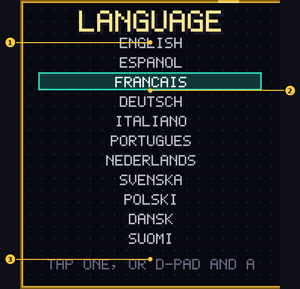
*The chooser. 1 English and the ten others, 2 the highlighted language (tap one, or use the d-pad and A), 3 the hint line. The language currently in use carries a gold star.*

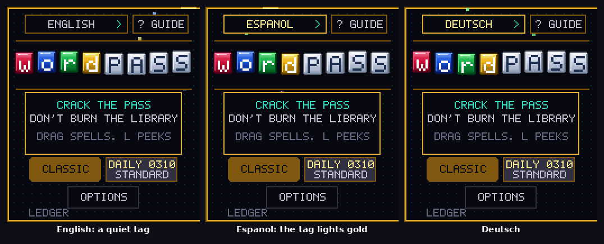
*The title's language tag. In English it is a quiet tag; in any other language it lights gold and shows that language's name, with a chevron: tap it for the next language.*

| Setting | Values | What it decides |
| --- | --- | --- |
| LANGUAGE | ENGLISH, ESPANOL, FRANCAIS, DEUTSCH, ITALIANO, PORTUGUES, NEDERLANDS, SVENSKA, POLSKI, DANSK, SUOMI | the tiles, the dictionary and the pass words (below) |
| LIBRARY | FULL, COMMON | whether rare words are accepted, in every language (COMMON keeps the 30,000 most frequent forms) |
| SPELLING | BOTH, AMERICAN, BRITISH | American and British spellings, **English only**: in every other language the row reads `ENGLISH ONLY` and does nothing |

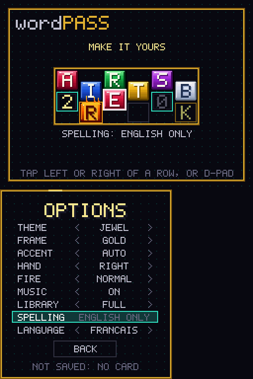
*The options with another language on. SPELLING becomes a note, not a choice.*

### 14.1 What a language changes

* **Tiles.** Each language has its own tile weights, letter values, vowels and rare letters, and the **Qu** tile only where the language has one. A letter a language hardly uses has no tile: no K or W in Spanish, no Q in Dutch, Swedish, Danish or Finnish.
* **Words.** The dictionary accepts that language's words (the dictionaries are "every word a player is likely to type", not complete: see `docs/LANGUAGES-DATA.md`).
* **Pass words.** Every shelf draws from a translated library of the **same 40 themes** in the same order, and the plaque and the shelf intro show the theme name in that language (`PASS - LIBROS`).
* **Daily boards are per language.** The Daily uses the active language's letter bag and pass pool, so a Spanish Daily is a different board from the English one, and the same for everyone playing Spanish that day. Records (best scores, the streak and the Ledger) are shared across languages.

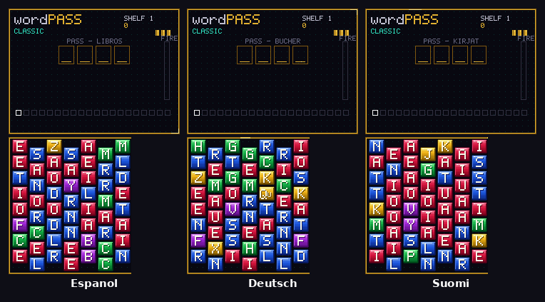
*The same game in three other languages. Top screens: the plaque (`PASS - LIBROS`, `PASS - BUCHER`, `PASS - KIRJAT`). Boards: the tiles come from each language's own letter frequencies.*

### 14.2 The limits

* **Letters are A to Z.** The board has 26 tile types, so words are normalised by stripping accents: an acute or grave vowel loses its mark, n-tilde is N, c-cedilla is C, umlauts and the ring lose their marks, o-slash is O, l-stroke is L, the German sharp s is SS, and the ae and oe ligatures are AE and OE. Words that become the same collapse into one. You spell the stripped word.
* **The menus, the in-game guide and the prompts stay English**; only the words, the pass words and the theme names are translated. The examples in this guide are English whatever the language.
* **Switching is only possible on the title and the options screen**; a shelf keeps the letters it was dealt.
* **Loading** a language shows a short LOADING screen (about a quarter of a second in the emulator). English is compiled into the program and always works; the other ten live in the ROM's own filesystem and are read into memory when chosen. If the filesystem is not there (a loader that strips it) only English is offered. The chosen language is saved with the other options, and one that is not on the ROM falls back to English.
* **Quality varies.** Finnish has the weakest word list, and Swedish and Danish have the thinnest pass pools (`docs/LANGUAGES-DATA.md`).

---

## 15. Troubleshooting and FAQ

**Why was my word refused?** Section 4.4 lists the four messages. NOT IN THE LIBRARY: not a dictionary word. TOO OBSCURE: LIBRARY is COMMON. AMERICAN SPELLING / BRITISH SPELLING: the SPELLING option.

**The game says SET CLOCK and Daily will not start.** The DS clock is unset (before 2025). Set it in the DS settings (or the emulator's date and time) and wait a second on the title.

**My score and settings vanish when I restart.** There is no card to save to. On DeSmuME the game runs without a FAT card, so records last for the session only. On a flashcart make sure the card has the DLDI patch for your cart. The options screen shows `NOT SAVED: NO CARD` when there is no card.

**It will not boot in DeSmuME.** Build with the pinned toolchain image `devkitpro/devkitarm:20240511` (libnds 1.8). ROMs built with the current libnds 2 boot in melonDS and on hardware but not in DeSmuME.

**It is slow.** The game runs at 60 frames per second on a real DS and in melonDS or DeSmuME at full speed. If a flashcart build stutters, try turning MUSIC off to rule out sound, and make sure the emulator's frame skip is off.

**My stylus does not hit the gem I mean.** A gem answers to a 12-pixel circle around its centre, the dead zones are between three gems; drag more slowly across a tight chain or use the d-pad.

**Why do hole numbers not go down when I find a letter?** They count every pass letter that touches the hole, found or not (section 6.3).

**I peeled under a flame and lost the pass!** Section 6.7. In peek mode the gems directly under a flame have a red double rim and the panel says RED: SCORCH.

**Is the Daily the same for everyone?** Yes for the same date, if everyone's clock reads the same date: the seed is the date (section 10.1).

**Can I play on a DSi or a 3DS?** The ROM is a plain DS game. It needs a flashcart or a loader that runs DS homebrew; this guide cannot vouch for every loader.

---

## 16. Appendix: tables, constants, file formats, credits

### 16.1 Letter values

<!-- check:values-az -->
| Letter | Value |
| --- | --- |
| A | 1 |
| B | 3 |
| C | 3 |
| D | 2 |
| E | 1 |
| F | 4 |
| G | 2 |
| H | 4 |
| I | 1 |
| J | 8 |
| K | 5 |
| L | 1 |
| M | 3 |
| N | 1 |
| O | 1 |
| P | 3 |
| Qu | 10 |
| R | 1 |
| S | 1 |
| T | 1 |
| U | 1 |
| V | 4 |
| W | 4 |
| X | 8 |
| Y | 4 |
| Z | 10 |

### 16.2 Multiplier, heat and the dictionary, by length

<!-- check:dict-counts -->
| Letters | Multiplier | Heat | Words | Rare tier |
| --- | --- | --- | --- | --- |
| 3 | x1 | 3 | 999 | 299 |
| 4 | x1 | 2 | 4006 | 1972 |
| 5 | x2 | 1 | 8894 | 5859 |
| 6 | x2 | 1 | 15712 | 11880 |
| 7 | x3 | 0 | 23782 | 19813 |
| 8 | x3 | 0 | 29385 | 25946 |
| 9 | x4 | 0 | 26750 | 24081 |
| 10 | x4 | 0 | 22162 | 20393 |
| 11 | x4 | 0 | 17065 | 15997 |
| 12 | x4 | 0 | 12521 | 11958 |
| 13 | x4 | 0 | 8563 | 8281 |
| 14 | x4 | 0 | 5604 | 5506 |
| 15 | x4 | 0 | 3494 | 3465 |
| 16 | x4 | 0 | 2110 | 2104 |
| 17 | x4 | 0 | 1202 | 1199 |
| 18 | x4 | 0 | 631 | 630 |
| 19 | x4 | 0 | 363 | 363 |
| 20 | x4 | 0 | 176 | 176 |

<!-- check:dict-total 183419 -->
The dictionary holds **183,419** words of 3 to 20 letters, **159,922** of them in the rare tier.

### 16.3 Constants

<!-- check:constants -->
| Name | Value | Meaning |
| --- | --- | --- |
| `COLS` | 7 | columns on the board |
| `ROWS` | 8 | rows on the board |
| `TILE_W` | 24 | gem width in pixels |
| `TILE_H` | 22 | gem height in pixels |
| `ODD_SHIFT` | 11 | how far odd columns drop, in pixels |
| `MAX_CHAIN` | 20 | gems in a chain |
| `MAX_WORD` | 20 | letters in the longest dictionary word |
| `WORD_BUF` | 48 | room for a spelled-out chain (every gem a Qu, plus the end mark) |
| `LEDGER_N` | 8 | words remembered per shelf for the repeat penalty |
| `SCORE_UNIT` | 10 | a word is (letter values) x (multiplier) x this |
| `LONG_WORD_LEN` | 7 | this many letters and up add the flat bonus |
| `LONG_WORD_BONUS` | 200 | the flat long-word bonus |
| `BURN_BONUS_PER_LETTER` | 30 | a word through a flame |
| `DIAMOND_CAP` | 2 | diamonds that count in one word |
| `PASS_LETTER_PER_SHELF` | 100 | every pass letter found pays this x the shelf |
| `SHELF_BONUS_PER_SHELF` | 1000 | the shelf bonus x the shelf |
| `SPEED_TURNS` | 40 | the speed bonus pays for every turn under this |
| `SPEED_PER_SHELF_TURN` | 25 | speed bonus per turn per shelf |
| `PERFECT_PER_SHELF` | 400 | PERFECT PASS bonus per shelf |
| `CLEAN_PER_SHELF` | 150 | CLEAN PASS bonus per shelf |
| `CLEAN_EXTRA_PEELS` | 2 | wasted peels a CLEAN PASS allows |
| `BOOKMARKS_MAX` | 3 | bookmarks in a run |
| `OVERTIME_TURNS` | 24 | turns before overtime heat, Classic |
| `OVERTIME_TURNS_LOCKDOWN` | 16 | the same in Lockdown |
| `LOCKDOWN_FROM_SHELF` | 6 | the first Lockdown shelf |
| `LOCKDOWN_TWIN_FIRE_TIER` | 2 | from this Lockdown tier every ignition lights two columns |
| `INK_SPILL_HOLES` | 3 | holes an INK SPILL opens with |
| `TWIST_DAMP_SLOWER` | 1 | DAMP: the fire creeps this many turns slower |
| `TWIST_DAMP_METER` | 2 | DAMP: the meter is this much shorter |
| `TWIST_BURIED_EXTRA` | 1 | BURIED: the pass is this many letters longer |
| `TWIST_BURIED_ROW` | 5 | BURIED: the pass lies in this row and below |
| `DAILY_LONG_LEN` | 7 | the Daily modifier LONG asks for this pass length |
| `POOL_MIN_LEN` | 4 | shortest pass word |
| `POOL_MAX_LEN` | 9 | longest pass word in the pools |
| `OPT_ROWS` | 9 | rows on the options screen |
| `ACCENT_COUNT` | 9 | accent settings (AUTO and eight colours) |
| `GUIDE_PAGES` | 8 | pages of HOW TO PLAY |
| `GHOST_IDLE_FRAMES` | 180 | idle frames before the guided shelf's ghost drag |

### 16.4 File formats

<!-- check:files -->
| File | Format | Size in bytes | What it is |
| --- | --- | --- | --- |
| `data/dict.bin` | WPD3 | 1,206,266 | the dictionary: magic, eighteen `u32` counts for lengths 3 to 20, then sorted fixed-width records per length |
| `data/pools.bin` | WPP1 | 122,045 | the pass words: magic, a theme count, per theme a name and six counts for lengths 4 to 9, then the words |
| `data/variants.bin` | WPV1 | 16,077 | the words spelled one way only, in the dictionary's layout |
| `wordPass.cfg` (on the card) | WPS2 | 136 | settings, records, the Daily state and the Ledger, with a CRC-16 |

* **dict.bin.** Letters are packed 5 bits each, big-endian and left aligned, so `memcmp` order is alphabetical. The record width follows the length (4 bytes for 3 to 6 letters, growing to 13 for 19 to 20), and bit 0 of the last byte is the **tier**: 0 common, 1 rare. The device binary-searches the group for the word's length.
* **variants.bin.** Same layout; bit 0 is 0 for an American-only word and 1 for a British-only one. A word it does not list is accepted under every SPELLING setting.
* **pools.bin.** A theme's header is 20 bytes: an 8-byte name (NUL padded, at most 7 letters), then six little-endian `u16` counts. Words of one length are stored back to back.
* **wordPass.cfg.** Magic `WPS2`, version 2, a CRC-16/CCITT-FALSE over bytes 8 to the end, then the options, the records and the lifetime statistics. A WPS1 file (28 or 32 bytes) is still read and migrated.

### 16.5 Building the game and this guide

```bash
make                   # the ROM (needs devkitARM), or:
docker run --rm -v "$PWD":/work -w /work devkitpro/devkitarm:20240511 make
make check             # native rule tests (gcc only)
make guide             # regenerates docs/img with tools/emu/screens.py, then runs tools/check_guide.py
```

`make guide` needs the ROM (`wordPass.nds`) and py-desmume. `python3 tools/check_guide.py` alone only needs gcc and checks this file against the repository. `python3 tools/emu/screens.py wordPass.nds --list` shows the pictures and `--only name` redoes one.

### 16.6 Credits and licences

* **wordPass** is MIT licensed (see `LICENSE`).
* **Word list**: ENABLE, public domain; about 11,000 additions derived from Princeton WordNet 3.1 (WordNet licence) and the dwyl english-words list (Unlicense), plus British spellings and modern words written for the project.
* **Common tier**: derived from hermitdave's FrequencyWords 2018 (CC BY-SA 4.0) and first20hours' google-10000-english.
* **Spelling variants**: derived from the wooorm/dictionaries `en` and `en-GB` Hunspell dictionaries (SCOWL, permissive licences) plus spelling rules.
* **Pass pools**: hand-written themes and lists derived from WordNet lexical categories (WordNet licence), ordered by the frequency list.
* **Profanity blocklist** (words that never become a pass): LDNOOBW (CC BY 4.0), google-profanity-words, zacanger/profane-words (MIT) and the project's own additions.
* **Toolchain**: devkitPro devkitARM and libnds. **Test tools**: DeSmuME through py-desmume, and Pillow for the pictures in this guide.

The full list of data sources is in `tools/words/SOURCES.md`.
