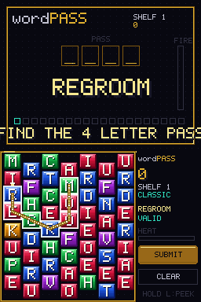
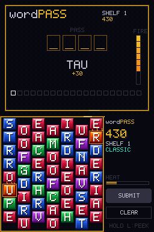
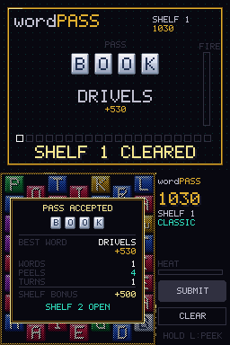

# wordPass

**Bookworm × Minesweeper for the Nintendo DS.**
Chain letters into words on a hex grid of gems. Behind the board hides a
password. Hold a shoulder button to *peek*: peel away letters you can spare
and uncover the pass. Spell weak words and the shelf catches fire.


## How it plays

- **Spell.** Drag the stylus across touching gems to chain a word (3+ letters),
  then tap **SUBMIT**, tap the last gem again, or press **A**. Scored tiles
  shatter and the column drops. Every word is a turn. The stylus is forgiving:
  a gem answers to a 12 px circle around its centre, a quick flick that skips a
  gem still picks it up when there is only one way through, and a drag never
  restarts the chain by accident (a gem it cannot reach flashes red instead).
  Tap an earlier gem to cut the chain back to it.
- **Peek.** Hold **L** or **R** (or press **X**, or tap the **PEEK** button, to
  latch it for one peel), then touch a gem to arm it and lift the stylus to
  peel it off the board. Slide off the gem before lifting to change your mind.
  Behind it is either a **pass letter** (a diamond you can still chain through)
  or a **number**: how many of the six neighbouring cells hide a pass letter.
  A peeled cell is a hole for the rest of the shelf; the gems below it still
  refill. Every peel is a turn too, and warms the shelf like a short word.
- **Fire.** Short words build **heat**: three letters add 3, four add 2, five
  or six add 1, seven and up are free; a peel adds 1 (2 in Lockdown). When the
  meter fills, the topmost gem of a column ignites. A new flame waits one turn
  before it starts to creep, then burns one row down per turn (every other
  turn on early shelves). Put it out by spelling a word through it. A flame
  hangs where it is when the gems under it are cleared. Holes are chimneys:
  fire falls straight through them. Diamonds are firebreaks.
- **Overtime.** Past turn 24 on a shelf (16 in Lockdown) every turn adds heat
  of its own, so a shelf you camp on eventually burns.
- **Scorching.** Peel a burning gem, or the gem directly under one, and the
  flame hits the back layer. If a pass letter was hiding there, it is gone.

### Scoring

- **Words.** Letter values (Bookworm weights, Qu = 10) summed, times a length
  multiplier (x1 up to four letters, x2 for five and six, x3 for seven and
  eight, x4 beyond), times 10. Seven letters and up add a flat 200. A word
  through a burning gem adds 30 per letter. Each diamond (revealed pass
  letter) in the chain adds half again, up to two, so a word through two pass
  letters scores double. Spelling a word you already spelled on this shelf
  halves it (the shelf remembers its last eight words: the ledger on the top
  screen shows the last five). The panel previews exactly what the chain is
  worth before you submit, with its length multiplier and the heat it will add.
- **Pass letters.** Every pass letter found pays 100 x shelf on the spot.
- **Clearing a shelf.** Shelf bonus 1000 x shelf, a speed bonus of
  25 x shelf for every turn under 40, and a peel bonus: **PERFECT PASS**
  (+400 x shelf) when every peel found a pass letter, **CLEAN PASS**
  (+150 x shelf) with at most two wasted peels.

The curve pays roughly twice what earlier builds did, so best scores saved
by older versions will be overtaken quickly: they were set under the old
numbers.

### Fail states

| Screen | Cause |
| --- | --- |
| LIBRARY LOST | a flame was still on the bottom row when the fire advanced |
| PASS DESTROYED | you scorched a cell that held a pass letter |
| OUT OF WORDS | no 3- to 5-letter word is left on the board |

### Modes

- **Classic**: climb the shelves. Fire pressure and pass depth rise as you go,
  with a twist every third shelf from shelf 4 and three bookmarks per run.
- **Daily Pass**: one fixed shelf for everyone, seeded from the DS clock date.
  Same board, same pass. Pick it from the title screen or press SELECT there.
  See *Daily Pass* below.

### Daily Pass

- **One scored attempt a day.** The first Daily you start on a date is the
  scored one: starting it spends the attempt, even if you quit from the pause
  menu (the score so far stands). Every later start that day is **PRACTICE**:
  the same board, announced as PRACTICE RUN, and nothing from it is recorded
  (not the score, the streak, or the lifetime stats). The title button reads
  PRACTICE with your score. The pause menu has no RESTART row in Daily.
- **Modifier of the day.** The date picks one, and the title button names it:
  STANDARD (as before), EMBER (the meter holds 8 and the fire moves every
  turn), DEEP (the pass is buried in the bottom three rows) or LONG (a
  seven-letter pass, or the nearest length the theme has). Everyone still gets
  the same board.
- **Streak.** A scored Daily on the day after your last one adds to your
  streak; a missed day starts it over. The title shows STREAK n from 2 days.
- **The DS clock.** Daily needs a clock that reads 2025 or later. If it does
  not (a DS whose clock was never set), the button reads SET CLOCK and Daily
  will not start.

### The Ledger

Press **X** on the title, or tap the BEST line under OPTIONS, for **THE
LEDGER**: games played, shelves cleared, words spelled, perfect passes, rare
words, peek accuracy (peels that found a pass letter), the daily streak, the
Daily best of its day, and your longest word and best-scoring word. A Classic
run counts as a game when it ends on its last bookmark, a Daily when its
scored attempt ends. B, X or any tap closes it.

### Options

From the title (OPTIONS button or Y). Tap the left half of a row to step its
value back and the right half to step it forward, or use the d-pad (up and
down pick a row, left and right change it, A steps forward); the chevrons on
the row flash when they act. The top screen shows a sample board in the
current theme, accent and frame and a line about the lit row. The list always
sits in the same place, so flipping Hand never moves a row from under your
stylus.

| Setting | Values |
| --- | --- |
| Theme | Jewel, Ink (slate gems with a tinted edge), Candy (pastels), Ember (warm), Clear (colour-blind safe: yellow, blue, magenta, teal and grey, which differ in lightness as well as hue) |
| Frame | Gold, Silver, Accent |
| Accent | Auto (changes per shelf) or one of eight fixed colours |
| Hand | Right or Left: mirrors the grid and panel for left-handed stylus play |
| Fire | Relaxed, Normal, Fast |
| Music | On, Off |
| Library | Full (every dictionary word) or Common (rejects obscure words with TOO OBSCURE) |
| Spelling | Both (default), American only or British only. A word spelled one way only (color / colour, center / centre, traveled / travelled) is refused in the other setting with AMERICAN SPELLING or BRITISH SPELLING. Words spelled the same everywhere, and the -ize / -ise forms, always pass. In every language but English the row reads ENGLISH ONLY and does nothing. |
| Language | English (default), Espanol, Francais, Deutsch, Italiano, Portugues, Nederlands, Svenska, Polski, Dansk, Suomi: see *Languages* below. |

Settings, records, the Daily state and the ledger are saved to `wordPass.cfg`
on the card when a FAT filesystem is available (flashcarts with DLDI, DSi SD).
The file is written to a temporary name and renamed over the old one, carries a
checksum (a damaged file falls back to the defaults) and still reads the older
28-byte format. Without a card they last for the session and the options screen
says so; if a write fails it says SAVE FAILED.

### Languages

The LANGUAGE option (the ninth row) and the language tag in the title's top left corner (tap it for the next
language) switch the whole game to one of ten languages: **Spanish, French, German, Italian, Portuguese,
Dutch, Swedish, Polish, Danish and Finnish**, besides English. The tiles come from that language's own
letter frequencies (each language has its own tile weights, letter values, vowels and rare letters, and the
Qu tile only where the language has one), the dictionary accepts that language's words, and every pass
word comes from a translated library of the same 40 themes, whose names the plaque and the shelf intro show
in that language. Library works in every language (Common keeps the 30,000 most frequent forms). The chosen
language is saved with the other options; one that is not on the ROM falls back to English.

The honest limits:

- **Letters are A to Z.** The board has 26 tile types, so words are normalised by stripping accents (a-acute
  is A, n-tilde is N, c-cedilla is C, umlauts and the ring lose their marks, o-slash is O, l-stroke is L,
  sharp s is SS, the ae and oe ligatures are AE and OE) and words that become the same collapse into one. You
  spell the stripped word. A letter a language hardly uses has no tile (no K or W in Spanish, no Q in Dutch
  and the Nordic languages), and words that need it are not in the dictionary.
- **The menus, the guide and the prompts stay English**; only the words, the pass words and the theme names
  are translated. The guide's examples are English whatever the language.
- **Daily boards are per language**: the Daily uses the active language's letter bag and pass pool, so a Daily
  in Spanish is a different board from the English one (and the same for everyone playing Spanish that day).
  Records (best scores, the streak) are shared across languages.
- **The first start shows a LANGUAGE chooser** (before the title; also from the title tag and A on the LANGUAGE row).
- **Spelling is English only** (it is about US and UK spellings); the option reads ENGLISH ONLY elsewhere.
- **The dictionaries are "every word a player is likely to type", not complete** (see `docs/LANGUAGES-DATA.md`:
  rare inflections are missing, Finnish has the weakest list, Swedish and Danish the thinnest pass pools).
- Switching language is only possible on the title and the options screen; a shelf keeps the letters it was dealt.

Loading a language shows a short LOADING screen (about a quarter of a second in the emulator). English is
compiled into the program and always works; the other ten live in the ROM's filesystem (NitroFS, folder
`lang/<code>/`) and are read into heap memory when chosen, the previous language's buffers freed first. If the
filesystem is not there (a loader that strips it) only English is offered. Words and pass words are credited
in `tools/words/SOURCES.md`.

### Shelves

Every shelf draws its pass from a themed pool, and the plaque on the top
screen names it (PASS - BINDERY). The **word library** holds about 17,900
pass words in 40 themes that cycle as you climb. The first eight shelves are
the bookish ones: **Bindery** (book, page, spine, jacket ...), **Ink** (nib,
font, quill, scribe ...), **Verse** (poem, rhyme, sonnet ...), **Tales**
(myth, fable, novel, chapter ...), **Atlas** (globe, compass, gazetteer ...),
**Archive** (codex, ledger, lexicon ...), **Lamp** (wick, candle, lantern
...) and **Study** (desk, shelf, lectern, bookmark ...). Then the library
opens out: **Beasts**, **Music**, **Herbal**, **Voyage**, **Cookery**,
**Myth**, **Anatomy**, **Play**, **Alchemy**, **Weather**, **Guild**,
**Smithy**, **Attire**, **House**, **Moods**, **Curses**, **Words**,
**Deeds**, **Motion**, **Traits**, **Clans**, **Minds**, **Folk**, **Times**,
**Making**, **Wares**, **Shapes**, **Change**, **Trade**, **States**,
**Events** and **Lexicon**. Every pool runs from familiar words to obscure
ones, and a shelf only draws from the first 48 + 24 x shelf words of it, so
early shelves stay familiar and deep ones open the whole shelf. Daily Pass
sticks to the familiar end. The pass gets longer with the
shelf: four letters on shelves 1-2, five on 3-5, six on 6-8, seven on 9-12 and
eight from shelf 13 (a pool without that length lends its nearest), and the
last eight passes of the run are not repeated while the pool has a choice.
The words are checked against the dictionary, and the library never goes
rougher than a mild curse: the strongest words in it are *holy*, *damn*,
*crappola* and *moobs*.
The letters themselves come from a shuffled bag of 100 drawn without
replacement, so a shelf never starves of vowels or drowns in them, J, Q, X and
Z appear at most twice a bag, and a column that refills with nothing but
consonants gets a vowel at the bottom. Daily boards use a separate random
stream from the sparks and shakes, so two players on the same date see the
same board, the same refills and the same fire.

Shelves 1-3 are **Classic**: fire moves every other turn, the pass sits high
and the heat meter holds 10. Shelves 3-5 tighten it to 7. From shelf 6 on it
is **Lockdown**: fire every turn, a heat pulse every six turns, the pass
buried low, and the music drops into a minor key. Lockdown climbs in tiers
every three shelves (the panel reads LOCKDOWN, LOCKDOWN II, III, IV): the
pulse comes faster, the meter shrinks, and from tier two (shelf 12) every
ignition lights two columns at once.

From shelf 4, every third shelf (4, 7, 10 ...) has a **twist**, announced as
you arrive and never the same one twice running:

| Twist | Effect |
| --- | --- |
| INK SPILL | three cells are already holes when the shelf opens |
| DAMP | the fire creeps one turn slower but the meter is two shorter |
| BURIED | the pass is one letter longer and lies entirely in the bottom three rows |

A Classic run starts with three **bookmarks**, shown as small books on the
top screen. A failed shelf costs one and you retry the shelf; with none left
the run is over. Restarting a shelf from the pause menu also costs one (it is
refused on your last), and clearing a Lockdown shelf earns one back, up to
three. Daily Pass has no bookmarks: one attempt.

## Controls

| Input | Action |
| --- | --- |
| Stylus drag | chain letters (drag back onto the previous gem to undo one) |
| Tap the last gem again | submit a valid word (it wears a gold ring) |
| Tap an earlier gem | cut the chain back to it |
| Tap a gem away from the chain | start a new chain there |
| A / SUBMIT button | submit word (with the d-pad cursor shown: chain the gem under it) |
| B | step the chain back one gem; hold 20 frames to clear it |
| CLEAR button / Y | clear chain |
| D-pad | move the hex cursor (see below) |
| Hold L or R | peek mode (touch a gem to arm it, lift to peel it; slide away to cancel) |
| X / PEEK button | latch peek on for one peel (press again to cancel); with the cursor shown, A then peels the gem under it |
| START / the II button on the panel | pause menu: RESUME, RESTART SHELF (costs a bookmark), HOW TO PLAY and QUIT TO TITLE. Up and down move the highlight, A or a tap on the lit row picks it (a tap on another row lights it first); RESTART and QUIT ask for a second pick within 90 frames. START or B resumes |
| LEFT / RIGHT or L / R (title) | flip the tip cards on the top screen |
| Y (title) | options |
| X (title) | THE LEDGER |
| B (title) / the GUIDE button | HOW TO PLAY, the in-game guide (see *Guide* below) |
| SELECT (title) | Daily Pass |

### Guide

HOW TO PLAY is eight pages of the rules you need, on the device. Open it with
the **? GUIDE** button in the title's top corner (or **B** on the title), or with the
HOW TO PLAY row of the pause menu in the middle of a shelf. Until the first
guided shelf has been done the GUIDE button pulses and the title's tip card says
NEW HERE? TAP GUIDE; the guided first shelf is the short form of the same
lesson, the guide is the long one.

| Page | What it teaches |
| --- | --- |
| 1 THE BOARD | dragging a chain, the gold ring, tapping the last gem (or SUBMIT or A), undo and cut back, with INK worth +70 |
| 2 SCORING | gem values, the length multiplier ladder, the flat +200 at seven letters, flames, diamonds, repeats, with Qu+I+Z worked out |
| 3 PEEKING | the shoulder buttons, X and the PEEK button, arm and lift, the hole numbers and their colours, diamonds, the red gems that scorch |
| 4 THE PASS | the hidden letters and their themes, the pass length by shelf, what a letter pays, the shelf, speed, PERFECT and CLEAN bonuses |
| 5 FIRE | the heat each word adds, what a peel adds, how a flame falls, chimneys and firebreaks, the three ways to lose a shelf |
| 6 SHELVES | bookmarks, the three twists, Lockdown and its tiers, overtime |
| 7 MODES | Classic, the Daily Pass (one scored try, then practice, the modifiers, the streak), THE LEDGER |
| 8 CONTROLS | touch, d-pad, buttons, and the options that matter |

The touch screen holds the words (key terms in the accent colour, numbers in
gold, warnings in amber), typed in line by line over about a second (any key
or tap finishes them at once) with a big NEXT and PREV button in the bottom
corners (they pulse until the first time you use one), eight page dots (the
active one breathes and rings when you arrive; tap one to jump), a BACK box
and a page counter. The two corners at the top swap with HAND: BACK takes the
stylus side. The top screen is a looping story per page, a little over four
seconds long, drawn with the board's own gems, holes, flames, diamonds and
heat bar and with a drawn stylus that does what the page teaches, with a ripple
where it presses: gems drop in with the board's own fall and squash, a stylus
drags I, N, K and the rope grows behind it with a spark, then taps the gold ring
and the gems shatter; Qu, I and Z each float up their value, the sum meets the
multiplier and the total counts up; the stylus reads the numbers of a peeled
patch (worked out from two hidden letters) while L is held; the pass slots fill
for three themes; heat fills a meter, a flame slides down a column a tile at a
time with new gems dropping in behind it, and a diamond stops it; a bookmark is
lost and won back, a twist banner slides in, the Lockdown tiers take the
highlight in turn; the stylus taps the title's buttons and the Daily's
calendar tile changes its modifier; the DS has each control pressed in turn.
Changing page dips the brightness for a few frames and sparks from the new dot.
LEFT and RIGHT, L and R, A, the buttons and the dots all flip pages (they wrap;
A on the last page closes), and B, START or BACK returns to the title or the
pause menu. Every number on a page is printed from
the same tables the rules run on (the multiplier ladder, the heat table, the
bonus and shelf constants, the pass length ladder), and `make check` fails if a
page drifts from them or a line outruns its width.

### Playing with buttons only

The whole game plays without the stylus. Press the d-pad and a cursor appears
on the board (a white and accent rim with a notch above it); up and down move
it a row, left and right a column, and it steps half a gem when the column
changes parity. **A** chains the gem under the cursor (it must touch the tail:
a flash of red says it does not), and **A** on the tail of a chain of three or
more submits it. **B** takes the last gem back, hold it for 20 frames to clear
the lot, **Y** clears at once. **X** latches peek, and **A** on the cursor then
peels that gem straight away; under a flame the rim turns amber. Touch the
screen and the cursor goes away and the stylus takes over again.

  

## Interface

Bejeweled on the front, N+ behind. Letter gems are faceted and glossy, colour
coded by letter group (vowels ruby, common consonants sapphire, rare letters
amber). The frame and pass plaque are gold. Everything else, including the
whole back layer you see in peek mode, is flat black with thin lines and a
single accent colour. Holding peek dims the gems to outlines with their letters
still readable, so the layer you are reading is always the one in colour. Hole
numbers are drawn large and colour coded (0 grey, 1 accent, 2 gold, 3 amber,
4 and up white). Gems directly under a flame pulse red with a blinking `!`:
peeling one scorches the back layer (the panel says RED: SCORCH). The armed
gem gets a pulsing double rim and a PEEL label.

Everything that happens gets juice: scored gems shatter into shards and the
score floats up from the chain, a found pass letter cracks open in a ring of
stars and pops into the plaque on the top screen, burning gems pulse with
flame tongues and shed sparks, callouts pop in at double size, shelves fade
in, and a failed run flashes and shakes the screen. The gold frames carry a
travelling shimmer and the submit gem breathes while a valid word is chained.
The title is a gold-ruled band of logo gems over a slow rain of falling gems in
the theme's colours; the pause menu is a card with the highlighted row boxed (its four rows are
RESUME, RESTART SHELF, HOW TO PLAY and QUIT TO TITLE).
The title screen's top half turns three illustrated tip cards every seven
seconds (LEFT and RIGHT, or L and R, flip them; the dots show which), the
first Classic shelf is guided (see below), and a nudge appears if you haven't
peeked after three words once you know the ropes, rejected words shake red, the chain rope turns the shelf accent once the word is valid, and a red
glow creeps up from the floor as fire gets low. Columns fall under gravity and
squash when they land, each shelf has its own
accent colour, and clearing a shelf slides up a results card: the pass lights
up diamond by diamond, then the score on the panel counts up to its new value
while the shelf, speed and perfect/clean pass bonuses fill in with it (a tap
skips to the end), and the card shows your best word, words spelled (and how
many were unique), peels used and turns, with a blinking NEW BEST when the run
beat a record. A failed shelf gets the same card in red: why it failed, the
pass revealed letter by letter (the ones you found stay lit), the same stats,
what the retry costs, and how many bookmarks are left. Finding a pass letter
pops its reward over the gem, a word through a diamond calls out PASS LINK,
a repeat says AGAIN, and the top screen keeps a fading ledger of the last
five words.

Fire reads without colour: a burning gem carries a light plate under a dark
letter and a bright bar across its top, in every theme, so it stands out from
a plain gem however the palette is tuned (the Clear theme is built for it).

The first Classic shelf is guided until you have done each thing once: sticky
prompts on the top screen ask you to drag a word, then to peek, say what the
first hole's number means, and call out the first pass letter you find; a
callout takes the line for its moment and the prompt comes back. A prompt slides
in from the right and settles. Each prompt also points at what to do on the
board itself: after three idle seconds a ghost stylus traces a real word on your
actual board, once; a valid chain gets a breathing ring and a bobbing stylus on
its tail gem; the PEEK button gets a ring until you start peeking; an armed gem
gets a stylus that lifts off it. A cue is gone the moment you act on it and
never shows while the stylus is down. The guide ends
for good once the closing tip has run or the shelf is cleared (the card
remembers). Hints name the shoulder under your idle hand: HOLD L when you play
right-handed, HOLD R when left-handed.

The panel keeps the books for you. Under the score the pass is a row of
small slots that fill with diamonds as you find its letters, then PEELS and
TURN. A chained word shows what it is worth and its length multiplier (X2 to
X4), and the HEAT line previews what the word will add to the meter, Lockdown
pulse and overtime included (NO HEAT for a free word). Past the turn budget
the label reads OVERTIME. While a flame burns, a row of pips counts the turns
to the next fire step and the label blinks NEXT on the last one (the FIRE
label on the top screen blinks with it). The buttons sink when you press
them, and a rejected word flashes its chain red. The big callout that pops
over the middle of the board (GOOD!, PASS LINK!, NOT A WORD, PASS LETTER!,
SCORCHED) stays out of the way while you are peeking. The top screen names
the mode under the logo (CLASSIC, LOCKDOWN II, DAILY EMBER, PRACTICE) with
the shelf's twist beside it for the first two seconds, and shows what the
chained word is worth under the big letters.

## Music

No samples: the soundtrack is sequenced live on the DS PSG channels so stems
can be mixed by game state.

- A fixed **hook** that never stops, in the form **A A B A**: the four-bar
  tune plays twice, then a four-bar answer phrase over a different chord
  walk (vi IV I V), then the tune again. Each shelf transposes it to a new
  key; Lockdown shelves play it in minor, with the raised seventh on the V
  chord (harmonic minor) so the turn home still pulls.
- **Pulse** arpeggio always on, plucked and ping-ponging between the
  speakers. **Bass** plays a riff of eighths (root, fifth, octave) while you
  keep spelling and fades after three quiet bars. **Pad** sits an octave
  under the lead and swells one chord tone per pass letter found.
- **Drums** layer up by word length and decay back. Level 1 is a closed hat
  on the off-beats; level 2 adds kick and snare (and a ghost kick before bars
  two and four); level 3 runs sixteenth hats with accents, an open hat at the
  top of every loop and a snare fill into the last beat of the fourth bar.
- **Alarm**: a pulsed two-tone blip that comes faster and louder the lower the
  fire has burned (every eighth step on the top rows, every step near the
  bottom). While a flame is on row 3 or lower the whole tune speeds up, and on
  row 5 or lower faster still; it relaxes one bar after the shelf is fire-free.
- **Word chimes** climb the chord with the length of the word: one note for
  three letters, two for four, three for five or six, four for seven (the last
  held with vibrato) and a six-note run for eight and up, which also lifts the
  pad for a moment. A word worth 500 or more rings louder, and a word that went
  through a flame hisses like steam.
- **Peek** ducks everything but the chimes and the alarm to a fifth and thins
  the pulse to a slow heartbeat an octave down; each reveal plays the next note
  of the hook, so peeling a path plays the tune.
- **Pausing** pulls the music down to a quarter (the alarm to half) and drops
  the pulse an octave; resuming brings it back with a short swell.
- **Finishing a pass** lands a fanfare on the next beat (a rising chord run on
  the chime, the pad snapping up, the bass on the tonic, a snare fill), then
  the hook loops an octave up, bright and without drums, for as long as the
  results card is open.
- **Failing** has three endings. Library lost slides the alarm down over a
  crackle; a scorched pass cracks and stabs, then slides; running out of words
  lets the hook sigh down four notes with no alarm. All three settle into a
  quiet bed (one low pad note and a slow bass toll) that never restarts the
  tune.
- **A new shelf** fades the old one out over a quarter second and comes in on
  the new key with one bar of bass and pulse alone, so starting a shelf from
  the title is an audible drop: the title plays the fuller attract mix (bass
  and hats always in, a steady pad and the hook at 60 on a mellow pulse).
- Eight voices (six pulse waves and two noise channels), each with its own
  instrument: the hook starts on a thin 12.5% pulse and fills out to 50%
  with a late vibrato, the pulse is plucked, the bass is round and the pad
  swells in. The lead sits an octave lower in the high keys (E, F, G, A), so
  the tune stays in a singable range in every key.
- **Stereo**: hook, bass and pulse in the middle, the pad a little right, the
  drums a little left, the chimes right, the hiss and noise effects far right,
  and the alarm far left.
- **Sound effects** run on their own small sequencer with priorities, so a
  small sound never cuts a bigger one: a rising pentatonic tap for each gem you
  chain (it climbs with the chain length and tops out at ten gems), a short
  step back when you drop one, a buzzing pair of notes for a refused word, a
  rush of air for a peel that finds nothing, a falling hiss and a sliding
  chime for a scorch, a rising flare when a flame is lit, a low crackle when
  the fire creeps, and a soft blip on every menu move.

## Performance

Both screens are software rendered straight into VRAM, with no RAM back
buffer and no per-frame copy. The touch screen uses banks A and B as a full
16-bit bitmap pair and the main background flips between them at vblank. The
top screen HUD has no back buffer, so it is drawn into bank C inside vblank,
one 48-row slice per frame: every primitive honours a vertical clip band, so
each region refreshes at 15 Hz without ever tearing or flickering, and a
change of layout (title/options to in-game or back) redraws all four slices
over two frames. Every state, including the results-card slide-in, the fail
shake and a pause pressed mid-cascade, runs at 60 fps: the title and options
screens skip the board entirely, and pause, results and fail screens render
the live board and let the 2D engine halve its brightness (a brightness-
decrease colour effect on the bitmap layer, windowed to the board strip with
the card cut out), so no CPU time goes into dimming or snapshotting. The hot
blitters (fills, gem blits, glyphs,
outlines, particles, backdrop, board, panel) live in ITCM and the gem sprite
cache, particles and popups in DTCM; every letter is pre-composited onto its
gem (and onto a diamond) once per theme, so a resting gem is twenty 48-byte
row moves, the backdrop is skipped under gems that are fully redrawn, glyphs
and gems are written directly after a single bounds test, and fills and blits
use word-aligned 32-bit stores (the left-hand layout starts the grid on an
even x for the same reason). The floor glow is painted into the backdrop and
only added over the three gems that reach into it, the note table is built
from one octave of integers (no libm), and the HUD counters use a local itoa
with the integer-only `siprintf` for the rest. Build
with `-DWP_PROFILE` to expose per-stage timings in `dbgT[]`.

## Building

Requires [devkitPro](https://devkitpro.org/wiki/Getting_Started) with the
`nds-dev` group installed.

```bash
make
```

Produces `wordPass.nds`. Run it in melonDS or DeSmuME, or on hardware with a
flashcart.

Without a local toolchain, the devkitPro Docker image works:

```bash
docker run --rm -v "$PWD":/work -w /work devkitpro/devkitarm:20240511 make
```

The release ROM and CI use the `20240511` image (libnds 1.8). Current
devkitPro (libnds 2 with calico) builds the same source without changes, but
ROMs built with it do not boot in DeSmuME; use melonDS or real hardware.

### Word library

`data/pools.bin` (format `WPP1`, about 122 KB) holds the pass words: a theme count, then
per theme a name and six counts for lengths 4..9, then the words of each
length back to back. `tools/gen_pools.py` builds it from hand-written lists
and WordNet-derived lists in `tools/words/pools`, filters every word against
the dictionary and a blocklist, and orders each pool from familiar to
obscure. `make pools` rebuilds it, and `tools/words/SOURCES.md` lists the
sources and licences (WordNet, FrequencyWords, ENABLE and the profanity
lists behind the blocklist).

### Languages (data)

`data/lang/<code>/` holds a dictionary (`dict.bin`, 147k to 220k words), a themed pass-word library
(`pools.bin`, the same 40 themes translated) and a tile table (`letters.bin`, weights, values, the Qu flag)
for Spanish, French, German, Italian, Portuguese, Dutch, Swedish, Polish, Danish and Finnish, 15 MB in
all, built from open Hunspell dictionaries, wordnets and subtitle frequencies by `tools/lang`. Words are
normalised to A-Z (diacritics stripped, sharp s to ss). The Makefile copies them into `nitrofiles/lang`,
which becomes the ROM's filesystem (the copy is not committed; `make clean` removes it), and the game reads
them from there (see *Languages* above). `docs/LANGUAGES-DATA.md` has the pipeline, the limits (Finnish has the weakest list,
Swedish and Danish the thinnest pools) and the exact file formats; `make check` verifies them.

### Dictionary

`data/dict.bin` holds 183,000 words of 3 to 20 letters: the public-domain ENABLE
list, plus about 11,000 additions (WordNet lemmas that are not names, inflected
forms of them that a second list confirms, British spellings and modern words).
It is in the `WPD3` format: a 4-byte magic, eighteen `u32` counts for lengths
3..20, then one sorted group of fixed-width records per length. Letters are
packed 5 bits each, big-endian and left aligned, so `memcmp()` order is
alphabetical; the record width follows the length (4 bytes for 3-6 letters,
growing to 13 for 19-20, 1.2 MB in all) and bit 0 of the last byte is the
**tier**: 0 common, 1 rare. The device binary-searches the group for the word's
length (one 32-bit compare per step for 3-6 letter words) and returns the
tier, which drives the RARE WORD callout and the Library option. A chain can
be 20 gems long; the chain preview drops from 3x to 2x letters past 13.

`data/variants.bin` (`WPV1`, 16 KB) lists the words spelled one way only, in
the same layout, with bit 0 telling American (0) from British (1). A word it
does not list is accepted under every Spelling setting. It is derived from the
US and GB Hunspell dictionaries plus a few spelling rules (`tools/derive_variants.py`),
and `make variants` rebuilds it. Rebuild the dictionary from any word lists
(comma separated, one word per line), plus an optional list of the words to
mark common:

```bash
make dict WORDS=tools/enable1.txt COMMON=tools/common_words.txt
```

`make dict` runs `gen_dict.py --verify` afterwards, which re-reads the binary
with a Python port of the device lookup and checks every input word (with its
tier) and 20 random non-words per length. `tools/common_words.txt` is the
ENABLE words that appear in the top 30,000 of the
[FrequencyWords](https://github.com/hermitdave/FrequencyWords) 2018 English
list (hermitdave, CC-BY-SA 4.0) or in
[google-10000-english](https://github.com/first20hours/google-10000-english)
(first20hours).

## Layout

```
source/main.c    state machine, input
source/board.c   hex grid, chaining, scoring, gravity, fire, peeling
source/dict.c    packed dictionary lookup
source/lang.c    the active language's letter tables (weights, values, vowels, Qu, rare letters)
source/langload.c  reads a language from the ROM filesystem (NitroFS, with a fast raw card path), LOADING
source/gfx.c     software renderer for both screens
source/music.c   PSG sequencer and adaptive stems
source/font.c    5x7 bitmap font
source/guide.c   the eight HOW TO PLAY pages, built from the rules' own tables
source/settings.c options, records, stats, checksummed FAT save, Daily clock and streak
source/debug.c   fixed-layout state mirror and poke channel for the test harness
tools/gen_dict.py  WPD2 dictionary builder and --verify round trip
tools/lang/      ten-language data pipeline (Hunspell expander, word, letter and pool builders, fetch.sh)
tools/check/     native rule tests: make check (gcc, no toolchain)
tools/emu/       headless DeSmuME harness, smoke.py and test_rules.py (see TESTING.md)
tools/common_words.txt
data/dict.bin
```

## License

MIT. Word list: ENABLE, public domain. Common-word tier derived from
hermitdave/FrequencyWords (CC-BY-SA 4.0) and first20hours/google-10000-english.

Language data credits (details and licences in `tools/words/SOURCES.md`): Hunspell dictionaries from
wooorm/dictionaries (Spanish, French, German, Italian, Portuguese, Dutch, Swedish, Polish, Danish);
OpenSubtitles frequencies by hermitdave/FrequencyWords (CC BY-SA 4.0); the Open Multilingual Wordnet
(MCR, WOLF, MultiWordNet, OpenWN-PT, Open Dutch WordNet, SALDO, plWordNet, DanNet, the Norwegian
wordnet, FinnWordNet) and Princeton WordNet 3.0; Open German WordNet (OdeNet, CC BY-SA 4.0) with the
Collaborative Interlingual Index; LDNOOBW bad-word lists (CC BY 4.0).
